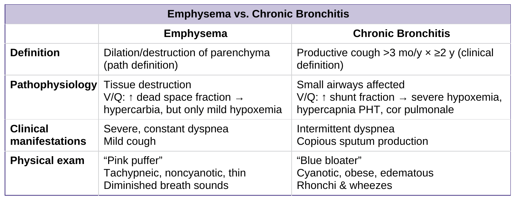
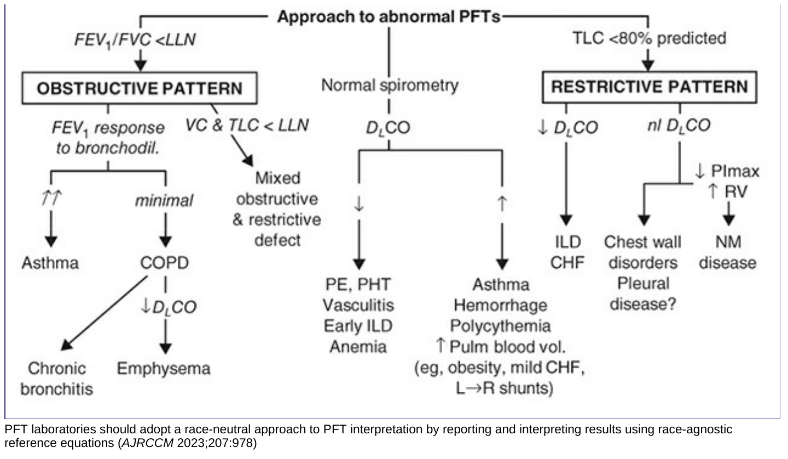
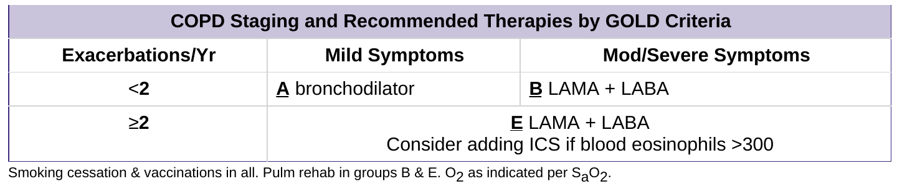
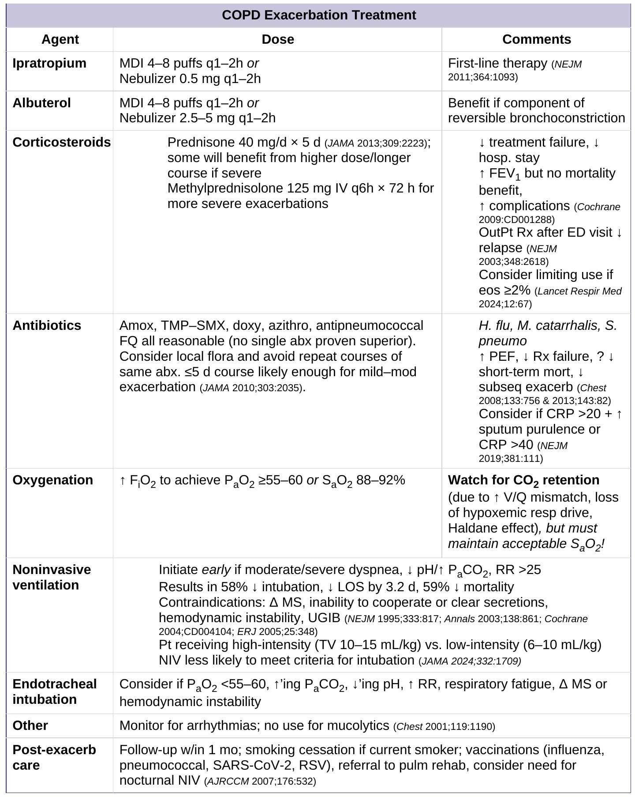

# 肺變小，為什麼反而能呼出更多氣？

> **私人修訂稿 V2｜編輯與醫學審查中，未公開部署。** 四張 Pocket Medicine 9E 原圖保留在相關推理位置，不修改原圖像素；公開重製權利尚未確認。2026-10-26 本輪重寫敘事，正式站與前版單檔 HTML 均未同步修改。

69 歲女性，曾吸菸，已規則使用 tiotropium、salmeterol／fluticasone，也完成三個月肺復健，走兩三百公尺仍得停下來喘。肺功能有阻塞，胸部 CT 更發現右下葉嚴重肺氣腫與過度充氣，將鄰近肺葉擠得難以伸展。

若氣喘來自「肺功能不夠」，讓一部分肺萎縮，理應更糟。醫師卻決定在右下葉支氣管放入單向瓣膜，讓這個肺葉逐漸縮小。**一個月後，她的肺總量減少，第一秒呼出的氣量反而幾乎翻倍。**<a href="https://pmc.ncbi.nlm.nih.gov/articles/PMC6473594/">Marchand 等人 2019 年的完整病例、Figure 1 與 Table 1</a>記載了這段病程。這不是 COPD 的一般處置，而是一個適合反過來檢驗「肺功能數值究竟測到了什麼」的病例。

全文只處理一條主線：**呼氣排空受限 → 過度充氣與呼吸負荷 → 症狀和治療目標分離 → 急性惡化時的通氣失敗**。四張小麻原圖依此順序帶讀；診斷和穩定期決策屬同一個疾病，但不是同一個量尺。

## 01　第零問｜肺功能到底在量什麼？

先把三件容易混成「肺功能差」的事拆開。

**第一，呼氣速度。** Spirometry（肺量計檢查）讓病人吸到最滿，再快速、持續呼出。**FEV₁** 是第一秒呼出的容積；**FVC** 是整次用力呼氣的總容積；**FEV₁/FVC** 是「第一秒能排出全部可呼出氣量的多少比例」。比例低，指向**呼氣氣流阻塞**，不直接代表肺總量小或血氧低。

**第二，留在肺內的氣。****RV（residual volume）** 是盡力呼氣後仍留在肺裡的殘氣量；**TLC（total lung capacity）** 是最大吸氣後的總肺容積。一般 spirometry 量不到 RV。當 RV/TLC 很高，肺內有一大部分空間被難以排出的氣占據。**FVC 低不等於限制型疾病**：也可能是氣困住而呼不出來；真要確認限制型通氣障礙，必須看到 TLC 低於參考正常下限。

**第三，氣體交換。****DLCO** 觀察氣體通過肺泡與微血管介面的能力。肺氣腫破壞肺泡壁及微血管床時常下降，但貧血、肺血管疾病也會影響它。於是低 FEV₁/FVC、RV 增加和 DLCO 降低，可以同時出現，卻分別描述**流量、容積、交換**三個不同問題。

再讀小麻的原表。左欄的 **emphysema（肺氣腫）** 是肺泡壁破壞的結構病變；右欄的 **chronic bronchitis（慢性支氣管炎）**，指排除其他原因後，至少連續兩年、每年三個月的慢性咳痰。兩者不是嚴重度的兩端，也可以同時存在。舊式 pink puffer／blue bloater 是歷史表型描述，不能拿外觀決定氧療、NIV 或 COPD 診斷。

<figure class="pocket-source-shot" id="pocket-copd-definitions-original">

小麻第九版原圖／原表｜reader PDF p85｜Emphysema vs. Chronic Bronchitis

<figcaption><strong>Pocket Medicine 9E 原圖：Emphysema vs. Chronic Bronchitis。</strong>原表四列均保留。pink puffer／blue bloater 是壓縮的表型描述，不是互斥診斷，也不是給氧或呼吸器的分流依據。 點圖可讀原尺寸；預覽檔可放大、捲動並關閉回到原段落。<a href="../runs/2026-10-26-copd-original-figures.md">原頁擷取、來源與待核範圍</a>。</figcaption>
</figure>

原表將 V/Q、shunt 等交換異常濃縮於兩欄；但**低 V/Q 不等於真正 shunt**：前者仍有部分肺泡通氣，後者沒有。從慢性咳痰、皮膚顏色或肺氣腫外觀，不能直接推出特定肺區的氣體交換比例。真正要問的是：眼前哪項證據屬於結構，哪項屬於症狀，哪項屬於功能？

## 02　第一問｜看到阻塞，為什麼還不能直接判 COPD？

在相符症狀、暴露或風險背景下，**支氣管擴張劑後 FEV₁/FVC < 0.70** 是 GOLD 2026 確認 COPD 持續氣流阻塞的操作性條件。CT 肺氣腫、長期吸菸、慢性咳痰都提高懷疑，卻不能代替這一步；反過來，未達固定門檻也不代表肺一定健康。

吸入支氣管擴張劑後重測，是排除暫時性氣道收縮的影響，不是做「有反應＝氣喘、沒反應＝COPD」的二選一。COPD 病人的 FEV₁ 可以有可逆成分；部分氣喘病人也可能有持續阻塞。**同一個治療反應，不能獨立證明病因。**

小麻的 PFT 圖可當成三條不同路徑來讀：**FEV₁/FVC** 先找阻塞、**TLC** 用來確認限制、**DLCO** 補充交換表面／血管線索。單一低 DLCO 不能補出不存在的阻塞，單一低 FVC 也不能推算 TLC 必低。

<figure class="pocket-source-shot" id="pocket-pft-original">

小麻第九版原圖／原表｜reader PDF p80｜Figure 2-1 — Approach to abnormal PFTs

<figcaption><strong>Pocket Medicine 9E 原圖：Figure 2-1 — Approach to abnormal PFTs。</strong>Figure 2-1 的編號／題名跨頁起於 p79，流程與 race-neutral reference equations 註腳在 p80。圖中的 bronchodilator response 箭頭是壓縮提示，不能單獨完成氣喘／COPD 鑑別；TLC <80% predicted 也不是本文取代 LLN 的新門檻。 點圖可讀原尺寸；預覽檔可放大、捲動並關閉回到原段落。<a href="../runs/2026-10-26-copd-original-figures.md">原頁擷取、來源與待核範圍</a>。</figcaption>
</figure>

圖中使用的 TLC <80% predicted 是教材簡化；臨床解讀應採適用參考式的 **LLN（lower limit of normal，正常下限）**。同樣地，固定 FEV₁/FVC 0.70 對年長者可能過度分類、對較年輕者可能漏掉異常。遇到接近門檻的數字，先查吹氣品質、重複性、臨床脈絡與 LLN，別讓四捨五入取代診斷。

確診後再以支氣管擴張劑後的 **FEV₁ % predicted** 分 GOLD 1–4（≥80%、50–<80%、30–<50%、<30%）。這量化的是**阻塞程度**，不是「還剩幾成肺」、也不是 A／B／E 症狀－惡化分組。[GOLD 2026 官方 Pocket Guide](https://goldcopd.org/2026-gold-report-and-pocket-guide/)將兩個評估軸分開。

## 03　第二問｜明明肺裡有更多氣，病人為什麼吸不滿？

正常呼氣仰賴肺的彈性回縮；肺氣腫使彈性回縮與小氣道支撐減弱，呼氣時氣道更容易塌陷。小氣道黏液、發炎及重塑又提高出口阻力。用力吐得更猛，不保證吐得更快；胸腔壓力上升還可能壓迫狹窄的小氣道。

結果不是單純「空氣進不去」，而是**上一口還沒排完，下一口已開始**。肺氣腫可使安靜時肺容積已偏高（靜態過度充氣）；運動或急性惡化時，呼吸頻率增加、呼氣時間不足，進一步形成 **dynamic hyperinflation（動態過度充氣）**。呼吸於更高的肺容積範圍運作，留下給下一口的吸氣空間變少，橫膈膜也被壓平、效率下降。

這讓一件看似矛盾的事成立：**病人不是缺肺容量，而是缺能反覆動用的容量。** 也因此，支氣管擴張劑即使未使 FEV₁ 明顯增加，仍可能透過減少困氣而改善活動時的喘。

回到 Marchand 的病人，真正有辨識力的是**同一患者、同一張 Table 1 的兩個時點**：

- 肺復健後、瓣膜前：TLC **6.75 L**、RV **5.19 L**，代表最大吸氣後有約 77% 的肺容積仍殘留在最大呼氣末。
- 瓣膜一個月後：TLC **5.84 L**、RV **3.36 L**；總肺容積下降 0.91 L，殘氣卻下降 1.83 L。
- 同時 FEV₁ **0.85 → 1.67 L**、FVC **1.31 → 2.40 L**、六分鐘步行距離 **340 → 399 m**。

<figure class="diuretic-figure" id="copd-volume-change">

原始病例數據・獨立重繪<strong>總氣量減少，不等於能動用的氣量也減少</strong>

<svg xmlns="http://www.w3.org/2000/svg" viewBox="0 0 350 430" style="width:100%;height:auto;display:block;max-width:480px;margin:auto" role="img" aria-label="同一患者減容前後肺容量堆疊圖：TLC 從6.75降至5.84公升，RV從5.19降至3.36公升，TLC減RV從1.56增至2.48公升。">
<rect width="350" height="430" fill="#fcfaf6"/>
<g font-family="sans-serif" fill="#243d36">
<text x="25" y="34" font-size="20" font-weight="700">裝瓣膜前（肺復健後）</text>
<text x="25" y="62" font-size="18">TLC 6.75 L</text>
<rect x="25" y="78" width="222.4" height="42" fill="#a36a48"/><rect x="247.4" y="78" width="66.9" height="42" fill="#31766c"/>
<text x="25" y="148" font-size="18">RV 5.19 L　｜　TLC − RV 1.56 L</text>
<text x="25" y="205" font-size="20" font-weight="700">裝瓣膜一個月後</text>
<text x="25" y="233" font-size="18">TLC 5.84 L</text>
<rect x="25" y="249" width="144" height="42" fill="#a36a48"/><rect x="169" y="249" width="106.3" height="42" fill="#31766c"/>
<text x="25" y="319" font-size="18">RV 3.36 L　｜　TLC − RV 2.48 L</text>
<path d="M25 344 H325" fill="none" stroke="#243d36"/><path d="M25 340 V350 M110.7 340 V350 M196.4 340 V350 M282.1 340 V350 M325 340 V350" fill="none" stroke="#243d36"/>
<g font-size="15"><text x="22" y="369">0</text><text x="106" y="369">2</text><text x="192" y="369">4</text><text x="278" y="369">6</text><text x="317" y="369">7 L</text></g>
<rect x="25" y="389" width="15" height="15" fill="#a36a48"/><text x="48" y="402" font-size="16">最大呼氣後仍留下的 RV</text>
<rect x="25" y="411" width="15" height="15" fill="#31766c"/><text x="48" y="424" font-size="16">TLC − RV：總量扣除殘氣</text>
</g></svg>
<figcaption>Marchand et al. 2019，Table 1 的 After PR 與 1 Month Post-EBV 欄。長度按同一公升刻度繪製；綠色是由 TLC−RV 算出的容量差，不是實測 FVC，更不是每口潮氣量或吸氣容量。本文同時核讀 <a href="https://pure.unamur.be/ws/portalfiles/portal/41203528/medicina_55_00065_v2.pdf#page=4">原 CT Figure 1</a>及<a href="https://pure.unamur.be/ws/portalfiles/portal/41203528/medicina_55_00065_v2.pdf#page=5">原 Table 1 與註腳</a>；圖是本站原創，不是原圖截圖。</figcaption>
</figure>

這裡的關鍵不是瓣膜「治好了氣道阻塞」。CT 看見的是過度膨脹的右下葉壓迫其他區域；單向瓣膜在確認目標葉缺乏顯著側枝通氣後，讓該葉縮小、其他區域重新伸展。減少的是低效率的過度充氣，換回的是呼氣和吸氣可用的機械空間。這需要專門團隊選案，並承擔術後氣胸等風險，不能由「LABA/LAMA 後仍喘」直接跳到肺減容。

**更值得注意的是她的 FEV₁/FVC：0.65 → 表列 0.70。** 論文作者描述她術後不再符合當時 GOLD 的 spirometric cutoff；但表列兩位小數，不能用 0.70 推論組織病變消失，也不能拿這個四捨五入的結果取代完整功能判讀。她三年追蹤期間仍有五次需門診抗生素治療的惡化。**改善阻塞、改善喘、消除未來惡化風險，是不同終點。**[原病例與長期追蹤](https://pmc.ncbi.nlm.nih.gov/articles/PMC6473594/)

## 04　第三問 A｜持續喘與反覆惡化，為什麼用藥不一樣？

門診先問「想解決哪個問題」，再看要不要加藥。

**LABA**（長效 β₂ 受體促效劑）與 **LAMA**（長效 muscarinic 受體拮抗劑）從不同訊號路徑放鬆氣道平滑肌，目的在減少阻力、改善排空與活動症狀。**ICS**（吸入型類固醇）則主要用於合適發炎表型下**降低未來急性惡化**；不是第三種即時支氣管擴張劑。因此，已用雙長效擴張仍喘，應先查吸入技術、裝置送藥、肺復健、過度充氣、心臟疾病、貧血與去適能；不能因「藥效不足」就自動加 ICS。

反過來，若問題是**已在維持治療下仍發生中重度惡化**，就要重新評估抗發炎策略。血中 eosinophil（嗜酸性球絕對數）可協助預測 ICS 預防惡化的可能效益：低於約 **100 cells/μL** 通常較小，接近或高於 **300 cells/μL** 時較強；這是連續風險訊號，不是單獨開藥的命令。LABA＋LAMA 後仍惡化、eos ≥100 時可評估三合一，但同時須衡量肺炎風險；若合併明確氣喘，ICS 的治療角色另須按氣喘原則處理。

GOLD 2026 的 **A／B／E** 是*初始治療*分流：前一年沒有中重度惡化，再按 mMRC 呼吸困難或 CAAT（原 CAT）健康影響區分 A、B；**只要前一年至少一次中度或重度惡化便進 E**。B、E 通常從 LABA＋LAMA 出發；E 且 eos ≥300 可考慮初始三合一。已在治療的人必須走 **follow-up** 路徑，不可每次回診都重新套初始 ABE。所謂惡化要核對真正事件與治療經過，不等於每天多喘了一點。

> **讀舊表的版本限制：** 下方小麻表取自 GOLD 2024 脈絡，保留原列與註腳，但其中事件次數的壓縮寫法**不能直接套用 GOLD 2026**。新版分流及 initial／follow-up 分別對照 [官方 GOLD 2026](https://goldcopd.org/2026-gold-report-and-pocket-guide/)。

<figure class="pocket-source-shot" id="pocket-copd-staging-original">

小麻第九版原圖／原表｜reader PDF p86｜COPD Staging and Recommended Therapies by GOLD Criteria

<figcaption><strong>Pocket Medicine 9E 原圖：COPD Staging and Recommended Therapies by GOLD Criteria。</strong>完整保留症狀欄、事件列與戒菸／疫苗／肺復健／氧療註腳；原表的次數欄是舊版簡化，不是完整歷史 GOLD 演算法，更不是 2026 現行流程。 點圖可讀原尺寸；預覽檔可放大、捲動並關閉回到原段落。<a href="../runs/2026-10-26-copd-original-figures.md">原頁擷取、來源與待核範圍</a>。</figcaption>
</figure>

原書表底下的戒菸、疫苗、肺復健、適應條件下的氧療也不能忽略：分類表只是藥物決策的一部分。Marchand 病人已使用 LAMA、LABA、ICS 仍受限，問題的主因之一是局部嚴重過度充氣。**治療完整，不等於病人的主要限制已被治到。**

## 05　第三問 B｜慢性排空問題，怎麼變成急性通氣衰竭？

急性惡化時，黏液、水腫、支氣管收縮使出口更窄；病人因缺氧、焦慮或呼吸負荷而加快呼吸，呼氣時間卻更短。每口氣的排空惡化，產生更高的呼氣末肺容積與呼吸功。**Dynamic hyperinflation** 說的是容積；**intrinsic PEEP／auto-PEEP** 說的是呼氣末尚存的肺泡正壓。兩者相關，但不是同一個測量。

<figure class="diuretic-figure" id="copd-expiratory-time">

原創力學示意・非患者曲線<strong>排氣尚未結束，下一口已經開始</strong>

<svg xmlns="http://www.w3.org/2000/svg" viewBox="0 0 350 355" style="width:100%;height:auto;display:block;max-width:480px;margin:auto" role="img" aria-label="兩條定性呼氣流速曲線。呼氣時間充足時流速可接近零；時間縮短時在仍有向外流量處已開始下一次吸氣，支持排空不足的判斷。">
<rect width="350" height="355" fill="#fcfaf6"/><g font-family="sans-serif" fill="#243d36">
<text x="23" y="32" font-size="20" font-weight="700">呼氣時間較充足</text><text x="23" y="58" font-size="16">向外流量 ↓，逐漸接近零</text>
<path d="M35 80 V151 H325" stroke="#243d36" fill="none"/><path d="M38 83 C65 126 120 147 265 150" stroke="#31766c" stroke-width="4" fill="none"/>
<path d="M280 80 V153" stroke="#31766c" stroke-dasharray="5 4"/><text x="175" y="178" font-size="16">下一口較晚開始</text>
<text x="23" y="217" font-size="20" font-weight="700">呼氣時間縮短</text>
<path d="M35 236 V302 H325" stroke="#243d36" fill="none"/><path d="M38 239 C55 267 88 283 132 289" stroke="#a36a48" stroke-width="4" fill="none"/>
<path d="M140 233 V305" stroke="#a36a48" stroke-width="3" stroke-dasharray="5 4"/><circle cx="132" cy="289" r="5" fill="#a36a48"/>
<text x="154" y="260" font-size="16">仍在排氣時</text><text x="154" y="284" font-size="16">下一口已開始</text>
<text x="25" y="331" font-size="15">零流量基線 ───　　時間 →</text>
</g></svg>
<figcaption>承接 Pocket Medicine 9E 的急性惡化與呼吸支持原表、GOLD 2026 的過度充氣生理，以及 IBCC 的排氣時間提醒。圖僅比較呼氣流速與下一次吸氣的時間關係，沒有模擬壓力數值、病人的 RV 或呼吸器設定。呼氣流速未回零可提示排空不足，但不能單憑這張定性圖量出 auto-PEEP。<a href="https://sheng-clinical-system.pages.dev/xiaoma-copd-sources.html">來源與適用界線</a>。</figcaption>
</figure>

肌肉原本還能用更大的力量維持換氣；直到負荷超出可持續能力，**alveolar ventilation（肺泡換氣量）** 降低，PaCO₂ 升、pH 降。肺泡換氣量是每分鐘真正送達參與交換肺泡的新鮮氣體量，不等於病人胸廓看起來動得快，也不等於每分鐘通氣量（minute ventilation，呼吸頻率 × 每口潮氣量）。所以**呼吸越快，仍可能排不掉更多 CO₂**。

補氧提高吸入氧濃度，**改善氧合不代表卸下呼吸功**。對容易高碳酸血症的急性 COPD，通常先以控制性給氧瞄準 **SpO₂ 88–92%**，並用血氣與臨床軌跡檢查有沒有 CO₂ 上升、酸中毒或其他病因；不能因怕高 CO₂ 就容許嚴重缺氧，也不能把 SpO₂ 98% 當作通氣成功。

**NIV（non-invasive ventilation，非侵襲性通氣）** 經密合面罩提供正壓支持，不用氣管內管。常用的 bilevel NIV 以較高的吸氣壓和較低的呼氣壓協助每口吸氣，降低呼吸肌負荷；適當呼氣壓也可能減少觸發呼吸的門檻，但壓力過高可使充氣更嚴重。**COPD 急性惡化合併高碳酸性呼吸性酸中毒（常見參考 pH ≤7.35、PaCO₂ >45 mmHg），又能維持氣道保護與合作、可密切監測者，是 NIV 的重要適用情境。** 不能只用單一 PaCO₂ 數值決定是否插管。

NIV 之後要重新看意識、呼吸功、面罩漏氣、pH／PaCO₂、氧合與循環；氣道保護不可靠、呼吸停止、嚴重不穩或支持下持續惡化時，應及時評估侵襲性氣道，不為湊齊某個 pH 門檻而延誤。插管後若只為壓低 PaCO₂ 不斷提高呼吸頻率，可能讓呼氣流尚未回零就開始下一口，進一步困氣、減少靜脈回流甚至造成低血壓。**呼氣時間本身就是治療的一部分**，但具體呼吸器設定仍須依床邊波形及反應處理。

## 06　同樣是「喘變嚴重」，什麼需要藥，什麼需要支持？

確診 COPD 不代表每次惡化都來自支氣管。肺炎、肺栓塞、氣胸、心衰竭與心律不整可能模仿，也可能觸發 COPD 急性惡化。把氣喘當成唯一問題，會錯過需要立即處理的替代病因。

小麻的急性表不是從 bronchodilator 一路升到插管的固定順序。它其實同時在處理**四件不同的事**：短效支氣管擴張改善阻塞；systemic corticosteroid 改善適用情境下的惡化恢復；抗生素處理有感染線索／符合指引條件者；氧療、NIV 或插管則是在氧合、通氣與氣道安全失敗時提供支持。這些處置常需並行，不能因第一種有效就取消後面必要的支持。

> **小麻原表安全註記：** 原表較高劑量 IV methylprednisolone 不是本篇的一般建議；Corticosteroids 註記「Consider limiting use if eos ≥2%」與所引 STARR2 研究的分派方向不一致，原文與更正全文未完成核對，不可當成停用類固醇規則。下圖原像素保留，疑義就地標出。

<figure class="pocket-source-shot" id="pocket-copd-exacerbation-original">

小麻第九版原圖／原表｜reader PDF p87｜COPD Exacerbation Treatment

<figcaption><strong>Pocket Medicine 9E 原圖：COPD Exacerbation Treatment。</strong>保留 Agent／Dose／Comments 三欄及氧療、NIV、插管、其他監測與惡化後照護各列。這是原書原表，不是本篇不加限定採用的處方單；版本與疑義在圖旁解釋，不改圖上的字句。 點圖可讀原尺寸；預覽檔可放大、捲動並關閉回到原段落。<a href="../runs/2026-10-26-copd-original-figures.md">原頁擷取、來源與待核範圍</a>。</figcaption>
</figure>

對需要全身性類固醇的急性惡化，GOLD 2026 一般短療程方向是 **prednisone-equivalent 40 mg/day、5 天**；能口服時不須單因病人在急診就使用高劑量 IV。抗生素須評估痰液膿性變化、感染證據、嚴重度、先前微生物資料及通氣需求，不能讓「急性惡化」四個字直接等於細菌感染。靜脈茶鹼不應視為常規救援階梯。

值得辨認原表的**證據層級**：STARR2 探討基層照護急性惡化，依血中 eos ≥2% 給 prednisolone、低於此值給 placebo 的 biomarker-directed 策略，與所有急性呼吸衰竭都停止 systemic steroid 完全不是同一推論。[STARR2 PubMed 原始試驗](https://pubmed.ncbi.nlm.nih.gov/37924830/)；[更正紀錄](https://pubmed.ncbi.nlm.nih.gov/38030376/)。未確認更正的具體字句之前，這個來源問題繼續保持 **HOLD**。

至於長期氧療，評估的是**穩定期、符合條件的慢性低氧血症**，不是因為病人走路喘，或單次急診血氣偏低就直接開永久居家氧氣。急性期出院後要重新核對戒菸、疫苗、吸入技術、肺復健、共病與後續氧合狀態。

## 07　兩道回扣病例的條件題

**題一。** 病人減容後 FEV₁ 由 0.85 升到 1.67 L，表列 FEV₁/FVC = 0.70。以下哪個結論最精確？

A. 已證明肺氣腫組織逆轉，所以不再可能急性惡化。  
B. 已改善可測得的呼氣流量，但是否仍符合固定診斷門檻須注意精度，結構病變與未來惡化風險不能由 ratio 消失。  
C. 因 TLC 下降，必然出現限制型肺病。  
D. 只要 FEV₁ 增加，RV 就不需再量。

看解析

**B。** FEV₁ 是流量相關的功能結果；TLC、RV 是容量；肺氣腫是結構；惡化是時間中的事件。此病例術後三年內仍有五次需門診抗生素治療的惡化，直接否證 A。C 把「TLC 有下降」誤成「TLC 低於 LLN」；D 再次混淆兩個測量。

**題二。** COPD 急性惡化病人 NIV 後 SpO₂ 由 86% 升到 92%，但仍極度費力、意識變差且 pH 持續下降。最重要的判斷是？

A. 血氧已達標，繼續觀察即可。  
B. 先把血氧拉到 100%，再處理其他問題。  
C. 立即重新評估 NIV 是否失敗、氣道保護與插管需求，同步尋找誘發或替代病因。  
D. 只要 PaCO₂ 高，就是 COPD 且一定不可插管。

看解析

**C。** 氧合、通氣、呼吸功與氣道安全是相互關聯但不可互相代答的指標；SpO₂ 達標不能抵銷意識和酸中毒惡化。NIV 是協助病人維持通氣的治療，不是延遲必要插管的儀式。

**正式國考題對讀：** [112（二）醫學（三）Q46：eos 與 ICS](https://sheng-clinical-system.pages.dev/xiaoma-exam-112-2-med3-q46.html) · [113（二）Q50：急性藥物處置](https://sheng-clinical-system.pages.dev/xiaoma-exam-113-2-med3-q50.html) · [115（二）Q46：FEV₁ 之外的決策](https://sheng-clinical-system.pages.dev/xiaoma-exam-115-2-med3-q46.html)。

本文真正需要記住的不是某個 cutoff，而是四個不能相互取代的終點：**流量、可動用肺容積、症狀負荷、未來惡化風險**。慢性治療針對其中一項改善，不保證另外三項跟著正常；急性時還必須再加上**通氣和氣道安全**。這就是為什麼，肺可以變小，病人反而更能呼吸；也為什麼，血氧變好，病人仍可能正在惡化。

---

資料與審核邊界：[Marchand 2019，病例及原始測值](https://pmc.ncbi.nlm.nih.gov/articles/PMC6473594/) · [GOLD 2026 Report / Pocket Guide](https://goldcopd.org/2026-gold-report-and-pocket-guide/) · [STARR2 原始試驗](https://pubmed.ncbi.nlm.nih.gov/37924830/) · [四張小麻來源圖對讀及公開權利 HOLD](../runs/2026-10-26-copd-original-figures.md)。本稿為私人閱讀修訂，尚未獲得獨立醫學審查；原書圖表不得據此視為已獲公開重製授權。
