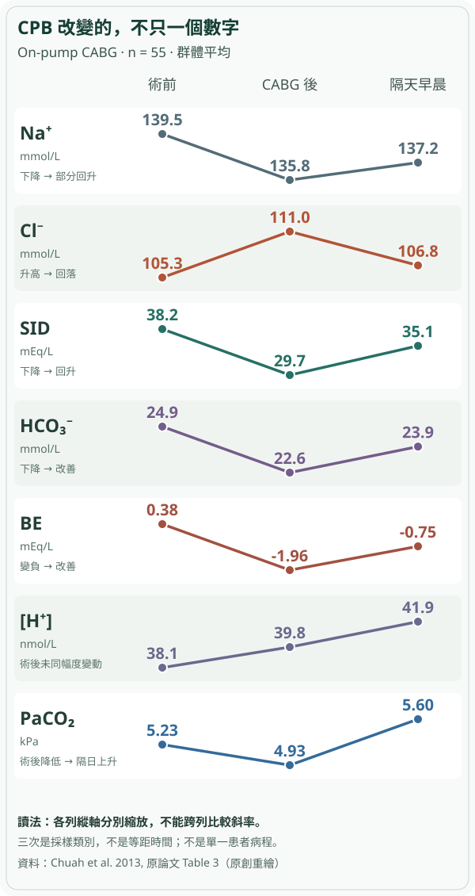

# 離開 CPB 後 HCO₃⁻ 降低：為什麼不能直接診斷 lactic acidosis？

CTICU ABG 深度系列・第三篇｜2026.10.29

病人剛結束心臟手術，麻醉醫師把一張血氣交到 ICU：HCO₃⁻ 比術前低、BE 變負。面對這兩個數字，我們容易順著一個熟悉的故事解釋：心肺繞道（cardiopulmonary bypass, CPB）造成組織灌流下降，乳酸堆積，因此出現 metabolic acidosis。

問題不是這個機轉不可能，而是**它只是一條候選路徑**。同樣的 HCO₃⁻ 下降，還可能來自血液與 CPB 管路內液體混合後，氯離子、其他強離子、白蛋白與未測量陰離子同時變化；甚至同一時間的 PaCO₂ 也會改變最終的 pH。若把酸鹼「結果」直接當成「病因」，便可能忽略正在出血、低心輸出或心包壓迫的危險，也可能為了修正一個尚未解釋清楚的 BE，不必要地追加輸液或 bicarbonate。

真正需要建立的不是另一張酸中毒分類表，而是三個不同層級：**這份血氣顯示什麼酸鹼過程？哪些來源同時推動它？哪一項病人證據足以決定現在要做什麼？**

## 一、先看原始觀察：酸化訊號明顯，pH 卻不一定跟著下降

Chuah 等人在 2013 年發表一項實際 CABG 觀察研究。81 名接受單純冠狀動脈繞道手術的成人被納入分析，其中 55 名接受 on-pump CABG、26 名接受 off-pump CABG。研究者不是在每個人身上連續記錄每一分鐘的酸鹼變化，而是在**術前、完成 CABG 並給予 protamine 後，以及隔天約早上六點**，取得三個時間點的動脈血檢驗。

其中 on-pump 組的平均值如下。這些數字是**55 名病人在各時間點的群體平均值**，不是一位特定患者的完整 ABG；也不能把每欄平均數當作某位病人的配對採檢來算 AG 或補償。

| 指標（on-pump CABG，n = 55） | 術前 | CABG 完成後 | 隔天早晨 |
| --- | ---: | ---: | ---: |
| Na⁺（mmol/L） | 139.5 | 135.8 | 137.2 |
| Cl⁻（mmol/L） | 105.3 | 111.0 | 106.8 |
| HCO₃⁻（mmol/L） | 24.9 | 22.6 | 23.9 |
| BE（mEq/L） | +0.38 | −1.96 | −0.75 |
| SID（mEq/L，研究計算值） | 38.2 | 29.7 | 35.1 |
| [H⁺]（nmol/L） | 38.1 | 39.8 | 41.9 |
| PaCO₂（kPa） | 5.23 | 4.93 | 5.60 |

*圖 1｜以 Chuah 2013 原始 Table 3 數字重新設計的多變數時間對照。不同列各自縮放，線條陡緩不能跨指標比較；三個採樣類別也不是等距時間。重點是讀出 Na⁺/Cl⁻、SID、BE、[H⁺] 與 PaCO₂ 的不同方向，而不是從圖推算某名病人的 pH 或治療效果。*

**先看術後立即的變化。** Na⁺ 降低、Cl⁻ 反而上升，SID 從 38.2 降至 29.7；HCO₃⁻ 與 BE 同步下降，符合淨代謝性酸化效應。但 [H⁺] 並沒有以同樣幅度顯著升高。研究比較 on-pump 與 off-pump 組，也發現前者在術後的 SID 下降更明顯（組間平均差 4.0 mmol/L，95% CI 2.8–5.3），卻沒有觀察到同樣顯著的 [H⁺] 組間差異。

**再看隔天。** Cl⁻ 往原值回落，SID 也改善；HCO₃⁻、BE 逐漸回復，但 [H⁺] 卻進一步上升。研究同時看到 PaCO₂ 上升，而且隔天已拔管的患者平均 PaCO₂ 高於仍插管者。這提示我們：下一個時間點的酸血症方向，不必沿著前一個時間點的代謝性變化走。

這並不是宣稱「CPB 不會造成酸中毒」。研究的限制恰恰提醒我們不能這樣說：手術方式不是隨機分派，液體種類與用量由臨床醫師決定；研究**沒有量乳酸，也沒有直接量白蛋白**，後者只由稀釋相關的 Hb 變化間接推測。因此它觀察到的是數個生理力量可能互相抵銷，而不是已測得每個力量精確的貢獻。原始論文 Table 3、Figures 1–3 所呈現的也是群體資料，不是個體因果實驗。

## 二、HCO₃⁻ 下降究竟在告訴我們什麼？

先拆開最容易混淆的兩件事。

**Acidemia（酸血症）**描述的是結果：動脈 pH 低於正常。**Acidosis（酸化過程）**則是會讓 pH 朝下降方向移動的生理力量。可以有 metabolic acidosis 而 pH 不低，因為另一個 respiratory 或 metabolic 的鹼化力量正好抵銷；反過來，pH 變低也不代表一定有新的乳酸生成。

ABG 直接測量 pH、PaCO₂ 與 PaO₂；許多血氣報告上的 HCO₃⁻ 是依 pH 和 PaCO₂ 由 Henderson–Hasselbalch 關係計算，並非又直接量到一份新的「血液酸含量」。BE 是在標準化 CO₂ 等條件下描述代謝性酸鹼偏移的指標。這兩項可以幫忙辨認**存在代謝性酸化成分**，但都沒有直接告訴我們它究竟來自 lactate、chloride、ketones、其他陰離子或腎臟處理改變。

換句話說，看見 HCO₃⁻ 由 24.9 降至 22.6，我們得到的是需要解釋的變化，不是已完成病因診斷。若只用「HCO₃⁻ 被酸消耗掉」解釋，會漏掉 CPB 最值得理解的地方：**大量液體進入循環後，血液電解質與弱酸組成都會改變，最終 pH 是它們與 PaCO₂ 一起作用的結果。**

## 三、為何 CPB 的液體可以讓氯離子成為酸化來源？

CPB 開始前，體外管路需要 priming fluid；患者原有的血液與新進入的溶液混合，可能同時發生 hemodilution、電解質比例改變、溶液緩衝陰離子進入與血漿蛋白下降。此後還有 cardioplegia、輸血製品、麻醉與 ICU 輸液等不同來源。因此「上了 CPB」並不等於「一定接受大量 normal saline」；必須回查實際使用的是哪種 prime、用了多少、何時採血。

生理上，Na⁺、K⁺、Cl⁻ 等屬於在此酸鹼尺度下近乎完全解離的 **strong ions（強離子）**。Stewart 的 physicochemical approach 把 **strong ion difference（SID，強離子差）**、總弱酸濃度（主要由 albumin 和 phosphate 影響）與 PaCO₂ 視為決定氫離子平衡的主要獨立變數。簡單的直覺是：在其他條件相近下，**Cl⁻ 相對 Na⁺ 增加，使 SID 下降，推動酸化**。這不是氯離子直接「把 bicarbonate 消耗掉」的化學反應；bicarbonate 也是離子平衡所呈現的結果之一。

在 Chuah 的 on-pump 群體資料裡，Na⁺ 由 139.5 降到 135.8，Cl⁻ 卻由 105.3 升到 111.0。這個「方向相反」比單獨宣稱 Cl⁻ 略高更有意義：不是每個電解質一起被稀釋，而是**相對離子組成**改變。研究依其定義計算 SID 從 38.2 降至 29.7，支持存在一股與強離子構成相關的酸化力量。

但這份原始資料不能把所有酸化歸因於 chloride。研究沒有同期乳酸值，也未直接量 albumin；液體種類與體積同樣有混雜。完整 Stewart SIDa 通常需要 Na⁺、K⁺、Cl⁻、Ca²⁺、Mg²⁺ 與 lactate 等資訊，不能只把 Na − Cl 的簡化差值稱作已測得的完整 SID，更不能把一個群體的平均值代回去創造某個病人的「個人 SID」。

## 四、為什麼強離子差下降，pH 仍可能相對穩定？白蛋白不是旁觀者

Albumin 除了維持膠體滲透壓，也是血漿中最重要的 nonvolatile weak acid（非揮發性弱酸）之一。當 CPB priming 造成稀釋，albumin 下降，總弱酸濃度降低，本身便產生**相對鹼化作用**。於是兩股力量可能同時存在：

**Cl⁻ 相對增加、SID 下降 → 酸化方向；albumin 下降、弱酸濃度降低 → 鹼化方向。**

最終測得的 pH 不一定能把兩個方向分辨出來。這也是為什麼即使 BE 和 HCO₃⁻ 變化不大，仍不能認為血液成分沒有發生明顯改變。

但這裡有一個關鍵的證據界線：2013 年 Chuah 團隊**沒有直接測得 albumin 的手術前後時序**。他們用 Hb 變化作 hemodilution 的間接訊號，提出 hypoalbuminemia 可能抵銷 SID 下降的解釋。這是合理、但尚未在該研究直接拆解驗證的機轉，不能寫成每位病人的已知原因。

另一項更早的研究提供了不同的直接證據。Hayhoe 等人 1999 年追蹤 10 名接受 CPB 的 CABG 病人，使用富含 chloride 與 polygeline 的 prime，檢測 chloride、albumin、lactate 和其他電解質。其群體中 standard bicarbonate 中位數由 25.0 降至 cooling 時 22.3 mEq/L，而 chloride 中位數由 104.9 升到 111.0 mEq/L；**同時 lactate 中位數卻從 3.20 降到 1.83**。研究也觀察到 strong ion gap 上升，提示除 Cl⁻ 外可能有未測得的陰離子參與；albumin 的稀釋則部分抵銷酸化。

讀到這裡，最重要的推理更新應該是：**乳酸上升不是 CPB 代謝性酸化的必要條件；但乳酸沒有上升，也不會自動排除同一病人其他器官的缺血。** Hayhoe 是 10 人、特定舊式 priming solution 的生理研究，不能直接推論今天所有成人 CABG 或瓣膜手術都具有同一大小的 chloride、SIG 效應。

## 五、AG 正常，能不能替這位術後病人排除「其他酸」？

此時自然會想到 anion gap（AG）：如果 HCO₃⁻ 下降，先計算 Na⁺ − (Cl⁻ + HCO₃⁻)，是否便能把高氯性與高 AG 代謝性酸中毒分清楚？

計算是必要的切入點之一，但在 CPB 術後有兩個特別容易失誤的地方。

第一，**albumin 本身是 AG 的主要未測陰離子來源**。若 albumin 因稀釋而下降，即使 lactate 或其他未測陰離子增加，未校正 AG 也可能不高。臨床需把同期 albumin 和當地實驗室參考區間納入解釋；低白蛋白時可採 albumin-corrected AG 作為篩查輔助，但校正值並不能證明陰離子的確切身分。若 albumin 未測、採血時間不一致，不應把「AG 正常」寫成排除高 AG 過程。

第二，**AG 不是 strong ion gap（SIG）**。AG 是由有限電解質計算的差額；SIG 是較完整的 physicochemical 模型中，表面強離子差與由 bicarbonate、albumin、phosphate 推得的有效強離子差之差。SIG 的意義建立在不同測量組件與方程式上，不能直接用 AG 或 BE 替代。2026 年 Guarnieri 等人對 50 名選擇性 CPB 心臟手術成人的觀察顯示，ICU 到院時平均 pH 7.33 ± 0.05、BE −3.87 ± 3.3 mmol/L、lactate 2.52 mmol/L，SIG 中位數由基線 6.0 升至 9.8 mmol/L。隔天 pH 回復，也不表示這類非乳酸未測陰離子訊號立即消失。

這項 2026 研究讓我們知道：除了 chloride 與 lactate，還可以存在其他非乳酸性酸化來源。**但它並沒有建立每位 CABG 病人都必須常規計算 SIG、或依 SIG 數字單獨治療的證據。** 對床邊照護而言，更實際的第一步仍是先取得同期 ABG、electrolytes、albumin、lactate，回顧 fluid input 和臨床循環狀況。

## 六、回到 ICU：推理要從「哪個病因會改變處置」開始

想像你是在接班時看見 HCO₃⁻、BE 下降的臨床醫師。**這一段是決策條件的教學推演，不是以上研究中某一名真實患者的病歷。** 即使我們已理解 Stewart，第一個判斷也不該是「要不要補 bicarbonate」，而是「是否有不能等的術後可逆危險」。

若患者同時有血壓下降、升壓藥劑量增加、胸管持續大量出血、尿量減少、心律不穩、皮膚灌流惡化或 echo 出現新的心室功能／心包問題，必須立即與心外、麻醉及 ICU 團隊評估出血、低 cardiac output、RV failure、tamponade、心肌缺血和其他 shock 機轉。**即使 lactate 不高、AG 不高，也不能讓高氯性酸化這個解釋延誤床邊搶救。**

若循環與器官灌流相對穩定，則要把不同證據放在正確時間點：

1. **採樣與呼吸條件：** 動脈或靜脈？採血時是在 CPB、剛離機、尚插管或已拔管？PaCO₂、FiO₂、呼吸器 minute ventilation 與溫度校正設定有無改變？先確認 pH 與 PaCO₂ 的方向，再辨認是否有代謝性成分及不適當代償。
2. **同時點代謝與電解質：** Na⁺、Cl⁻、K⁺、HCO₃⁻、lactate、albumin、必要時 phosphate 與 ketones。AG 及校正 AG 可以幫忙篩查是否有需要追問的其他陰離子，但**單次 AG 不替代病因證據**。
3. **術中輸入與腎臟時間序列：** CPB prime 的配方與體積、cardioplegia、晶體液、colloid、輸血、chloride exposure、尿量、腎功能變化。不同液體可能推動不同強離子、弱酸及未測陰離子效應。
4. **再量測真正的變化：** 若 chloride 與 SID 方向回復、BE 改善，但 PaCO₂ 上升且 pH 反而下降，就要重新評估有效換氣及呼吸肌／支持條件；若 lactate 持續上升、vasopressor 需求增加，即使 chloride 也很高，低灌流與其他危險仍必須追查。

這四組不是「先驗出高氯，再不管其他」的流程，而是不同候選機轉的**辨別性證據**。例如，Cl⁻ 相對 Na⁺ 上升且 lactate 穩定，會提高液體組成造成非乳酸性代謝酸化的合理性；但這個模式不能區分每個細胞是否灌流足夠。另一方面，lactate 上升也可能由生產、利用與清除多項因素造成，不能單靠它給 shock 分型，更不能因為它下降便宣布手術後危險解除。

還有一個處置的反事實：若 ABG 顯示的是嚴重酸血症合併高血鉀、循環崩解，或急性呼吸衰竭，立即處理的優先序會完全不同；不能拿前述「群體輕度高氯性變化」當作保守等待的理由。**Bicarbonate、補液、換液、調整通氣或 renal replacement therapy 都不是看到某個 HCO₃⁻ 數字就能自動啟動的選項**；須依臨床失代償、成因、pH／PaCO₂、容量狀態、腎功能與電解質後果評估。

## 七、那是否應該改用 balanced prime？

理解機轉後，才適合轉到治療證據。若較高 chloride exposure 可能促進代謝性酸化，改變 priming fluid 的組成是否能改善臨床結果？

2024 EACTS/EACTAIC/EBCP 成人 CPB 指南（2025 年刊出）指出，normal saline 或不平衡的膠體 prime 可能造成 hyperchloremic acidosis。少數小型隨機試驗比較不同 balanced prime，發現某些配方可降低酸鹼擾動，但指南也明說：**仍缺乏足夠大型、以重要臨床結局為終點的 RCT**，不能由「BE 較漂亮」直接跳到死亡率、AKI 或神經結果更好。

同樣值得保留的反例是，液體不只有 chloride 一種特性。2009 年一項 20 人隨機試驗中，Plasma-Lyte 148 相對於含 bicarbonate 的 prime，CPB 啟動後出現較大的 transient SIG 增加，研究者推測與 acetate／gluconate 等外源陰離子有關；**這不是證明 balanced solution 有害，而是說明「氯較低」不能自動等同於「所有未測陰離子都較少」**。更晚近的研究也顯示 priming strategy、額外液體負荷與不同弱酸／未測陰離子之間仍有交互關係。

所以選 prime 是術中麻醉與 perfusion 團隊的整體決策；已經進入 ICU 的患者，更不能因為術中接受某一種液體就跳過當下血流動力與器官狀態評估。

## 八、把整張 ABG 放回同一個病人

回頭看 Chuah 等人的三個時點：術後立即，chloride、SID、HCO₃⁻ 和 BE 已改變，但 [H⁺] 沒有同幅度上升；隔天 chloride 和 SID 回復，PaCO₂ 卻上升，最終酸鹼狀態再次改變。你現在應該能同時容納三件事：**酸化來源可以並存；它們可以互相抵銷；而 pH 是結果，不是來源標籤。**

真正的 CTICU ABG 推理不在於把「hyperchloremia、lactate、hypoalbuminemia」依次填進一張表。它在於：先辨認現在有沒有需要立刻救的病人，再問這份採樣告訴你哪個酸鹼過程，以及哪些競爭機轉能產生同一個結果；最後用**同時間的血氣、電解質、血流動力與術中輸入**，看哪一項新資料會真正改變病因判斷和下一步處置。

### 三個能檢驗自己是否真正理解的問題

**第一問。** 離開 CPB 後 HCO₃⁻ 下降、BE 變負，但 lactate 不升高，為什麼仍可能有 metabolic acidosis？如果同期 Cl⁻ 相對 Na⁺ 增加，這會如何改變候選機轉，而不能證明什麼？

**第二問。** 若 Cl⁻ 從高點下降、BE 改善，隔天 pH 反而下降，你會先核對哪一個血氣變數與呼吸支持事件？為何不能只沿著 chloride 追蹤？

**第三問。** 一位心外術後患者 lactate 正常、未校正 AG 正常，但血壓持續下降且胸管出血增加。哪些觀察是必須立即處理的危險？為何「可能是高氯性酸中毒」不能被拿來排除它們？

### 參考與延伸

- Chuah CS, Kirkbride R, Alston RP, Irons J. *Hydrogen ion concentration and coronary artery bypass graft surgery with and without cardiopulmonary bypass.* J Cardiothorac Surg. 2013;8:184. **主文依原始 Table 2–3 與 Figures 1–3，群體資料而非單人病例。** [原始全文](https://link.springer.com/article/10.1186/1749-8090-8-184)；[Table 3](https://link.springer.com/article/10.1186/1749-8090-8-184/tables/3)。
- Hayhoe M, et al. *The aetiology and pathogenesis of cardiopulmonary bypass-associated metabolic acidosis using polygeline pump prime.* Intensive Care Med. 1999;25:680–685. **本次取得 PubMed 摘要，未取得可目視的全文 Table／Figure。** [摘要](https://pubmed.ncbi.nlm.nih.gov/10470571/)。
- Guarnieri M, et al. *Acid-Base Disturbances After Cardiac Surgery: A Cohort Study Using the Physicochemical Approach.* J Cardiothorac Vasc Anesth. 2026;40:204–213. **本次取得 PubMed 摘要，非原始個體病歷。** [摘要](https://pubmed.ncbi.nlm.nih.gov/41130846/)。
- Wahba A, et al. *2024 EACTS/EACTAIC/EBCP Guidelines on cardiopulmonary bypass in adult cardiac surgery.* Eur J Cardiothorac Surg. 2025;67:ezae354. [指南全文](https://pmc.ncbi.nlm.nih.gov/articles/PMC11826095/)。
- *Acid-base effects of a bicarbonate-balanced priming fluid during cardiopulmonary bypass: comparison with Plasma-Lyte 148.* 2009 randomized study. [摘要](https://pubmed.ncbi.nlm.nih.gov/19115651/)。
- van den Brom CE, et al. *Impact of Colloid Cardiopulmonary Bypass Priming Strategy on Perioperative Acid–Base Balance in Coronary Artery Bypass Surgery.* 2026. **本次只取得期刊摘要，研究群體結果不等於個體療效。** [研究摘要](https://pubmed.ncbi.nlm.nih.gov/42791111/)。

延伸閱讀：本系列前篇《CABG lactate／ScvO₂》與《CPB oxygen delivery》分別處理**組織灌流訊號不等於病因**、以及**SaO₂ 不等於氧輸送**；一般酸鹼篇處理 Winter、AG 與混合障礙。本文專注於 CPB 液體、強離子、弱酸、通氣四種力量的臨床相互作用，並未將既有基礎章節重寫一次。
