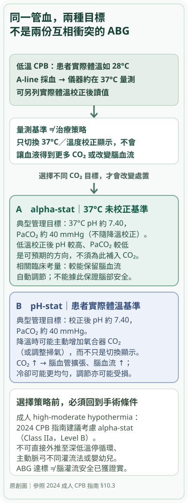

# 低溫 CPB 的同一份血氣：alpha-stat 與 pH-stat 為什麼會導向不同的 CO₂ 管理？

CTICU ABG 深度系列・第四篇｜2026.10.29

一份動脈血氣送進分析儀，儀器測得 pH、PaCO₂，結果卻可能同時提供「以 37°C 測量」與「依病人體溫校正」的兩組讀值。這不是血液在同一瞬間有兩種互相衝突的酸鹼狀態；它反映了**氣體溶解度與酸鹼平衡都受溫度影響**。真正需要決定的，則是手術團隊打算依哪一套目標調整人工肺的 CO₂ 排除或加入。

成人冠狀動脈繞道的歷史隨機試驗已經顯示，這種選擇不只是報告格式不同。1996 年 Patel 等人將 70 位接受 CABG 的患者隨機分派到 alpha-stat 或 pH-stat，術後六週的神經心理測驗惡化，在 pH-stat 組為 **17/35（48.6%）**、alpha-stat 組為 **7/35（20%）**。研究也測了腦血流及代謝，但這不是證明任何個別患者腦損傷一定來自 CO₂，更不能把當年的 CABG 結果直接套用到今天所有主動脈弓、深低溫停循環與小兒手術。

這個差異迫使我們先理解一個基礎問題：**究竟是血氣分析儀在 37°C 測到什麼、病人體內在較低溫度實際有什麼，以及我們真正調整了什麼？**

## 一、先分開量測與治療：一管血、兩種溫度基準、兩種管理策略

Blood gas analyzer 通常在接近 **37°C** 的分析溫度下測得 pH、PCO₂、PO₂；即使患者實際處在 28°C 的低溫 CPB，儀器上的預設結果仍可能是按 37°C 報告。若輸入患者當下溫度，儀器可依校正模型另列「temperature-corrected」的 pH、PCO₂、PO₂。

為什麼需要兩種資訊？因為在同一份血液氣體總量與成分近似不變的條件下，溫度下降使氣體溶解度提高，**同一份血的氣體分壓下降**；與此同時，緩衝體系的溫度依賴性改變，使體內較低溫度下的 pH 會比 37°C 檢測值更高。這是物理化學的方向性敘述，不代表病人正在發生新的代謝性鹼中毒，也不能以量測溫度更換直接宣稱氧輸送已改善。

因此，低溫 CPB 讀到「未校正 pH 7.40、PaCO₂ 40 mmHg」時，應先問：**病人幾度？這是 37°C 未校正數字，還是實際體溫校正後數字？**

尤其不能把兩種讀值拼成「同一張 ABG」：用 37°C 的 pH 搭配低溫校正的 PaCO₂，再計算 HCO₃⁻ 或解釋代償，會因測量基準混合而產生不一致。採樣時點與 CPB 降溫／回溫階段也必須一致。

但**僅僅切換顯示為 temperature-corrected values，不會改變病人體內的 CO₂ 或腦血流**。下面兩種管理策略真正的差異，在於團隊會不會為追逐不同目標，主動改變氧合器排出 CO₂ 的量，甚至加入 CO₂。

## 二、alpha-stat：保留 37°C 的基準，而不是把患者加溫回 37°C

Alpha-stat 管理在低溫 CPB 時，**以 37°C、未按病人體溫校正的血氣**作為酸鹼管理基準。典型方向是讓此基準下的 pH 接近 7.40、PaCO₂ 接近 40 mmHg；它不是要在實際 28°C 的患者體內維持「校正後 pH 7.40」。

在實際降溫時，即便未校正讀值仍在原本目標附近，低溫校正後的 pH 通常較高、PaCO₂ 較低。這不是儀器出錯，而是該策略**容許**較低溫下的自然酸鹼平衡方向。為什麼容許？「alpha」源於 histidine imidazole 側鏈的解離比例。傳統 alpha-stat 假說認為，在溫度變化時保留適當蛋白質緩衝基團的解離狀態，有助於維持細胞內蛋白與酵素功能；但這個理論本身不等於已證明較好的臨床神經結局。

同時，未刻意提高 PaCO₂，通常可相對保留部分 **cerebral autoregulation（腦血流自動調節）**。腦血管對 CO₂ 非常敏感：當 CO₂ 升高，腦血管擴張，血流增加；血流增加可能有利於某些情況的降溫與供氧，但也可能改變腦血流的分布及對血壓的調節。這些不是「血流越多越好」的單一方向問題。

因此，alpha-stat 不只是把一張血氣上的溫度校正功能關掉；它是**選擇不為了讓低溫校正的 pH 回到常溫目標，額外增加 CO₂ 負荷**。

## 三、pH-stat：既然校正後 pH 偏高，為什麼要主動增加 CO₂？

pH-stat 採取另一個基準：**把病人實際體溫下校正後的 pH、PaCO₂ 作為管理目標**。在典型低溫 CPB 中，如果直接依原有 CO₂ 水準降溫，實際溫度校正後的 pH 往往高於 7.40，PaCO₂ 低於 40 mmHg。因此 pH-stat 管理可能向氧合器供氣加入 CO₂ 或調整掃氣，以使**低溫校正值**回到目標附近。

這樣一來，同一個 28°C 的病人，如果採 pH-stat 策略，於 37°C 分析得到的未校正 pH 反而可能低於 7.40、PaCO₂ 高於 40 mmHg。**不能把這張報告看到的低 pH 直接診斷為異常高碳酸呼吸衰竭**，因為這可能正是低溫手術中刻意採用的 CO₂ 管理策略；然而如果已離開 CPB、開始回溫、呼吸器設定與時點改變，也不能把術中策略當作所有新發酸血症的解釋。

pH-stat 的生理效應與其風險，從 CO₂ 造成的腦血管擴張開始理解：較高 PaCO₂ 可增加 cerebral blood flow，可能使腦部降溫更均勻，對腦血流自動調節尚未成熟的嬰幼兒或某些極低溫情境特別有討論價值。但同一條 CO₂ → cerebral vasodilation 的路徑，也可能造成腦血流自動調節受損、腦部充血，以及增加微栓子抵達腦循環的機會。這些路徑構成可檢驗的競爭機轉，不是足以靠生理學就裁決所有術式的結論。

*圖 1｜先區分「血氣的溫度基準」與「臨床真正調整 CO₂」，再分辨兩種策略可能影響的腦循環。此圖為原創概念模型，不是病人的兩份實測血氣；成人 high-moderate hypothermia 的建議有特定適用範圍。*

## 四、臨床證據：為什麼成人 CABG 常偏向 alpha-stat，卻不能一概而論？

真正能從「生理上可能比較好」走到「臨床應該採用哪一種」的，是限定適用人群的比較試驗。

**Patel 等人 1996 年隨機研究**：70 名 CABG 成人分成 alpha-stat 與 pH-stat，每組 35 人；術後六週符合神經心理測驗惡化標準者，alpha-stat **7/35（20%）**，pH-stat **17/35（48.6%）**，p = 0.02。這是特定年代、特定 CPB 技術、以神經心理測驗作為結局的比較，不是今天所有手術中的 stroke、死亡率或長期認知功能風險比例。

**Murkin 等人 1995 年隨機研究**：316 名 CABG 成人，採取灌流脈動性與 pH 管理的 2×2 隨機分派。整體 CABG 病人的 stroke 發生率 2.5%，未發現各 CPB 組之間顯著差異；但對 **CPB 超過 90 分鐘**的病人，術後兩個月的 cognitive dysfunction 在 alpha-stat 相對 pH-stat 為 **27% vs 44%（p = 0.047）**。這是研究中的時間分層發現，不能把 27% 與 44% 說成所有 316 人的整體絕對風險，也不能擴大為 alpha-stat 能防止每一種神經損傷。

這兩項 RCT 對核心機轉形成重要的臨床支持：**在研究所涵蓋的成人 CABG 中，維持腦血流自動調節可能比單純增加腦血流更重要**。然而要知道有沒有可轉用的結論，還要看術式、降溫程度、CPB 時間、腦灌流策略、患者年齡與當代設備是否相近。

**2024 EACTS/EACTAIC/EBCP 成人 CPB 指南（2025 年刊出）**在 §10.3 的 Recommendation Table 52，建議：對於接受 high-moderate hypothermia 的成人心臟手術，**應考慮（should be considered）alpha-stat**，Class **IIa**、Level **B**，依據包括上述神經學與神經認知比較。這不是 Class I 的普遍強制規定，也不是「所有成人、任何溫度、任何術式都一定以 alpha-stat 最佳」。尤其**deep hypothermic circulatory arrest（DHCA）與 aortic arch reconstruction**，還涉及單側或雙側 antegrade cerebral perfusion、降溫速度、腦氧監測、是否停循環等獨立變項；不能把中度低溫 CABG RCT 的效果不加區分地搬過去。

## 五、主動脈弓與嬰幼兒：相同 CO₂ 機轉，為何結論可能改變？

假設術式從一般 CABG 變成需要極低溫或停循環的 aortic arch surgery：目標不再只是維持常態血流下的腦血流自動調節，而包含**如何在停循環前達到足夠且均勻的腦部冷卻**，以及何時恢復與分配選擇性腦灌流。pH-stat 的 CO₂ 相關血管擴張因此可能有不同的效益權衡，卻仍伴隨潛在 hyperemia 或 embolic burden；此處不能單靠前述 1996 年 CABG 的 17/35 vs 7/35 裁決。當代成人 aortic arch 的溫度管理、SACP 與腦監測須分別查看指南對應章節，不能把血氣策略當作唯一保護因素。

如果患者換成 cyanotic infant 或接受先天性心臟病手術的嬰幼兒，腦血管反應、成熟度與術式完全不同。一些小兒研究與後續系統性整理討論 pH-stat 可能使腦部冷卻較快且較均勻。但**這不能反過來證明成人 DHCA 都應採 pH-stat**。年齡、心臟解剖與 perfusion strategy 是會改變 EBM 適用性的條件，而不是例外註腳。

這個議題尤其需要對文獻的「研究對象」保持敏感。Abdul Aziz 與 Meduoye 在 2010 年的最佳證據綜述整理了低溫停循環的既有研究，指出成人與小兒研究呈現不同方向的結果；**它是既有研究的評述，不是又一項新的隨機試驗**。近年的彙整若將綜述誤當 RCT，或將心跳停止後的治療性低溫研究誤歸為手術低溫停循環，就會錯估直接證據。這也是為什麼本文對成人 CABG 的結論仍以對題 RCT 與成人 CPB 指南為主；在主動脈弓與小兒情境，必須重新確認實際術式、降溫階段與臨床結局，不能用混合研究中的概括結論代替。

## 六、真正值班時，看到「pH 7.30」要先問什麼？

這一節是**情境式判讀**，不是 Patel 或 Murkin 研究某一位病人的實際病程。若 CTICU 交班拿到的 ABG 印著 pH 7.30，第一個問題不是「要補 bicarbonate 嗎」，而是：**這是哪個時刻、什麼溫度、用哪一種顯示基準的血氣？**

首先確認採樣在 CPB 降溫中、回溫中、離機後，還是已回 ICU；有無使用 alpha-stat 或 pH-stat、是否輸入病人體溫，兩種 pH／PCO₂ 是按 37°C 還是 temperature-corrected 報告。在低溫 pH-stat 過程中，37°C 基準的 PaCO₂ 可能刻意較高，不代表後續術後任何高碳酸都可以忽略。

接著回到病人本身：如果已離機、開始回溫或恢復常溫，仍需按目前的 pH、PaCO₂、HCO₃⁻、氧合、通氣與灌流評估真實的 respiratory 或 metabolic disorder。氣道、呼吸器設定、有效肺泡換氣、出血、低心輸出、乳酸、電解質與溫度回升要在**當下同一時點**配對；不能用術中一份 blood gas 的溫度策略，解釋隔了數小時的新休克或呼吸惡化。

再做一個反事實：若 ABG 數字看起來完全正常，但低溫 CPB 現場的腦氧監測惡化、MAP 不穩或單側灌流不足，能否據此認為策略安全？**不能。** 血氣的 CO₂ 目標不是腦灌流是否足夠的直接測量；同樣，調整 CO₂ 讓 pH 達標也不能代替檢查是否有術式相關的腦缺血與灌流失衡。

最後辨認臨床責任邊界：CPB 的掃氣量、CO₂ 混合比例與腦保護策略由麻醉、心外與 perfusion 團隊依術式及機構流程共同決策；這篇文章幫助讀者**理解為何不能把 37°C 的血氣當成所有溫度的唯一生理目標**，不是提供不依病人條件自行調整氧合器 CO₂ 的操作處方。

## 七、回到最初那 70 名 CABG 病人

Patel 等人隨機比較的不是「同一份報告誰讀得比較準」，而是兩套會**實際改變 CPB CO₂ 管理**的策略。這就解釋了為什麼結果可能與腦血流自動調節及術後神經心理測驗有關。從這個研究得到的最重要原則，既不是「pH-stat 一定不好」，也不是「校正溫度比較真實所以一定更安全」，而是：

**溫度決定氣體分壓與 pH 如何呈現在儀器；策略決定臨床團隊用哪一個基準改變 CO₂；患者、術式和腦灌流目標決定那個改變可能帶來什麼風險與效益。**

只要把這三個層次分開，低溫 CPB 的 ABG 才不會被誤讀成一般 ICU 的單張酸鹼報告；同時也不必將 alpha-stat/pH-stat 變成需要無條件背誦的優缺點表。

### 三問檢驗

**第一問｜基本機轉。** 同一份低溫血液，為什麼儀器在 37°C 報告的 pH、PaCO₂ 和在患者實際溫度校正的值不同？只把顯示模式從 37°C 切換到 28°C，病人體內會因此得到額外 CO₂ 嗎？

**第二問｜臨床決策。** 如果在低溫 CPB 中刻意讓「校正後 pH 7.40」，為什麼 37°C 未校正的 pH 可能呈現較低？誰真正改變了 PaCO₂？這個變化如何影響腦血流與自動調節？

**第三問｜過度推論。** 成人 CABG RCT 支持 alpha-stat 對某些神經心理結果較好，能否直接宣布所有主動脈弓深低溫停循環或所有小兒手術都應使用 alpha-stat？如果不能，還缺哪些病人、術式、灌流和結局證據？

### 主要證據

1. **Wahba A, et al.** 2024 EACTS/EACTAIC/EBCP Guidelines on cardiopulmonary bypass in adult cardiac surgery. *Eur J Cardiothorac Surg.* 2025;67:ezae354. §10.3 與 Recommendation Table 52（成人 high-moderate hypothermia：alpha-stat Class IIa, Level B）。[指南全文](https://pmc.ncbi.nlm.nih.gov/articles/PMC11826095/)。
2. **Patel RL, et al.** Alpha-stat acid-base regulation during cardiopulmonary bypass improves neuropsychologic outcome in patients undergoing CABG. *J Thorac Cardiovasc Surg.* 1996;111:1267–1279. 70 人 RCT，六週 7/35 vs 17/35。[PubMed 摘要](https://pubmed.ncbi.nlm.nih.gov/8642829/)。
3. **Murkin JM, et al.** A randomized study of the influence of perfusion technique and pH management strategy in 316 patients undergoing CABG surgery. II. Neurologic and cognitive outcomes. *J Thorac Cardiovasc Surg.* 1995;110:349–362. 2×2 RCT；超過 90 分鐘 CPB 的認知結果 27% vs 44%。[PubMed 摘要](https://pubmed.ncbi.nlm.nih.gov/7637352/)。
4. **Goldstein C, Richter E.** pH Stat vs Alpha Stat. OpenAnesthesia，2026-08-31 更新。用於量測溫度、CO₂ 與 histidine imidazole 的生理說明，不取代 RCT／指南。[專題全文](https://www.openanesthesia.org/keywords/ph-stat-vs-alpha-stat/)。
5. **Abdul Aziz KA, Meduoye A.** *Is pH-stat or alpha-stat the best technique to follow in patients undergoing deep hypothermic circulatory arrest?* *Interact Cardiovasc Thorac Surg.* 2010;10:271–282. **最佳證據綜述，非 RCT；僅用於檢視成人與小兒／不同術式的適用性問題，不當作新的療效試驗。** [PubMed](https://pubmed.ncbi.nlm.nih.gov/19914925/)。
6. **Hydrogen ion (pH) and gas behavior during deep hypothermic cardiopulmonary bypass: Physiology and clinical implications.** 2026. 近期生理回顧，作為溫度依賴性與臨床爭議的補充，不當作新療效 RCT。[PubMed 摘要](https://pubmed.ncbi.nlm.nih.gov/42332422/)。

前一篇處理 CPB prime、chloride、SID、albumin 與 PaCO₂ 疊加的代謝性酸鹼機轉；這一篇專注**低溫時血氣測量基準與 CO₂ 管理策略的區別**，兩者互補但不可互相取代。
