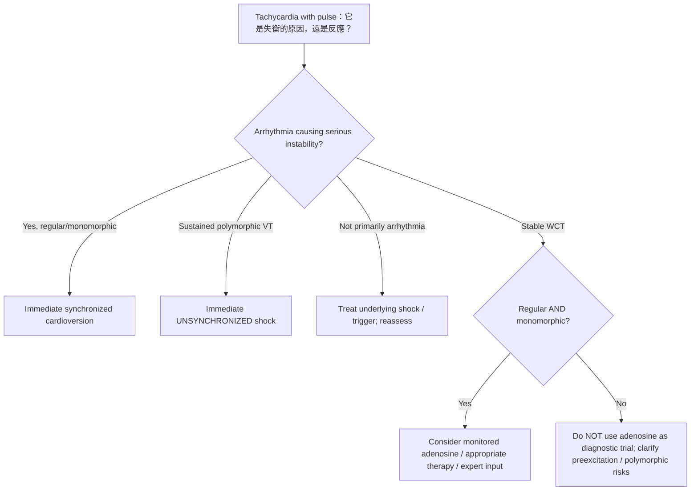

# WCT／ACLS｜2026-07-17 小麻閱讀原稿回收與醫學查核（2026-10-26）

**收錄身分**：作者於 2026-10-26 對話提供的 2026-07-17 全文，存放於 `archive/xiaoma-reading/intake/2026-07-17-wct-acls-user-supplied.md`。此為 **user-supplied private source snapshot**；不是已核實的 Facebook 作者定稿、不是 AI 審核正稿，亦未公開發布。歷史原文不得因以下勘誤而覆寫。

## 一、原始證據與圖片存取層級

1. **作者文字**：2026-10-26 對話直接貼出〈還不知道是什麼，憑什麼治療〉完整正文；已逐段回收並獨立存檔。尚無 Facebook 發布 URL 或版本身分核實。
2. **第一張截圖**：本次對話上傳 `Adult Tachycardia With a Pulse Algorithm`，標註 © 2020 American Heart Association。已**目視**核對：第一分叉為 persistent tachyarrhythmia **causing** hypotension／shock 等，後分 wide QRS ≥0.12 秒；stable WCT adenosine 限 regular and monomorphic。截圖沒有作為公開圖像資產提交。
3. **第二張截圖**：本次對話上傳 Pocket Medicine 9E「Wide-Complex Tachycardias (WCTs)」頁面的圖片，已**目視**核對可見的病因清單、monomorphic／polymorphic VT、favor VT 的心電圖線索與 VT management 摘要。沒有取得、反查完整 Pocket Medicine 9E 原 PDF 頁碼與所有小字／腳註；標記 `figure_original_pdf_review=pending`。不得冒稱已逐註腳審定。原書截圖不因私下研究使用即自動具有公開再利用權利。
4. **2025 AHA 當前正式流程圖**：核對官方 [Adult Tachyarrhythmia With a Pulse Algorithm (©2025)](https://www.heart.org/-/media/CPR-Files/CPR-Guidelines-Files/2025-Algorithms/Algorithm-ACLS-Tachycardia-250514.pdf)，包含 energy 與兩種 antiarrhythmic infusion 用藥內容。與 2020 截圖區分，尤其舊版 sotalol infusion 在 2025 **簡化流程圖**已移除（2025 完整 ALS guideline 的 WCT 推薦仍將 IV sotalol 列為可考慮的藥物；不能說 guideline 全面禁用）。
5. **2025 AHA ALS 原始指引全文**：[Part 9: Adult Advanced Life Support](https://cpr.heart.org/en/resuscitation-science/cpr-and-ecc-guidelines/adult-advanced-life-support)，核對 §15 Wide-Complex Tachycardia 與 §16 Polymorphic VT；可公開連結原來源而非複製完整授權圖。
6. **2023 ACC/AHA/ACCP/HRS AF 指引**：[preexcited AF 分支](https://pmc.ncbi.nlm.nih.gov/articles/PMC11095842/)，核對 hemodynamic instability、stable preexcited AF 使用 procainamide／ibutilide 的界限以及 contraindicated AV-nodal blocking agents。

**圖片保存缺口**：對話裡的兩張二進位原圖未實際上傳進 Git repository；本次保留其檔案來源描述、視覺核對結果、官方 AHA 2025 可合法連出的 URL。完整、可重現的圖像驗收仍需確認原書 PDF 所在與著作權分流。**不可對外標示「原圖已附」或「全部 Figure／Table 已驗收」。**

## 二、原稿主要認知貢獻與增量判別

- **A（作者原已完整論證）**：sinus tachycardia 可為 shock 反應而不是致病 rhythm；stable 與 unstable 不固定屬於某種 rhythm；WCT 不是 VT 的同義詞；regular／monomorphic 是有限介入邊界，不是診斷；adenosine response 不能獨立確診 SVT。AI 不能把這些重新包裝成自己補出的洞見。
- **B（跨篇連結）**：將 2026-07-11 accessory pathway／WPW 與 2026-07-16 AF 原稿接入 WCT，特別是 preexcited AF 的 AV nodal blockade 風險；兩篇目前仍 `conversation_only`，不得冒充網站現有完整連結。
- **D（會影響安全的必要校正）**：本文語句「只有當 ECG 已把高風險的可能性排除在這條路徑之外」可能暗示 regular monomorphic ECG 本身足以排除所有危險；實際僅滿足 **在 hemodynamically stable、regular、monomorphic 且具監測與立即救援條件時，adenosine 可考慮**的特定操作限制，不能作全域安全證明。
- **D（處置的類型）**：文章將 tachycardia 造成 shock 與 cardioversion 概括連結，須額外對讀 **sustained polymorphic VT → immediate unsynchronized defibrillation**（2025 ALS Class 1），而不是因仍有 pulse 就等待同步電擊；monomorphic WCT 合併 hemodynamic instability 則採 synchronized cardioversion。
- **D（高危藥物）**：未分型 WCT 不可經驗性使用 verapamil 或 diltiazem（2025 ALS Class 3: Harm）。若是 **preexcited AF**，依 2023 AF 指引，IV adenosine、beta blockers、verapamil、diltiazem、digoxin、IV amiodarone 為禁忌；不能把常見 AF RVR 的 rate-control 用藥照搬到 irregular WCT。
- **C（特殊病因）**：2025 ALS 提醒 hyperkalemia、sodium-channel blocker toxicity 有時也呈 WCT，單純針對 rhythm 終止而未處理誘因可能失敗。是否需要在教學整合稿補入，取決於篇幅及閱讀目標。

## 三、邏輯安全邊界（下一版整合稿必修）

| 床邊資訊 | 能確定的事 | 不能宣稱／需要立即避免的錯 |
|---|---|---|
| Shock + sinus tachycardia，感染或失血等高度可疑 | 先處置 underlying shock、同時監測 rhythm | 不可由「心跳快 + 血壓低」推出必須 cardioversion |
| Abrupt WCT + perfusion rapidly failing，規則單形態 | 懷疑 rhythm 為 hemodynamic failure 主因，優先同步電復律 | 不必等 VT 精確起源、scar pattern 或每項鑑別完成 |
| Hemodynamically stable + **regular monomorphic** WCT | 可以考慮 adenosine 作治療／幫助診斷，持續監測與備援 | 不能宣稱「是 SVT」、也不能假設 stable = benign |
| Irregularly irregular wide QRS／疑 preexcited AF | 必須辨識 accessory-pathway 傳導及危險藥物 | 不可將此病例視為「regular WCT 可以試 adenosine」 |
| Sustained polymorphic VT | 立即 **unsynchronized** shock；之後檢查 QT、缺血、電解質／誘因 | 不可先試 adenosine 或以 synchronized cardioversion 延誤 |
| Pulseless VT／VF | 進入 cardiac arrest／defibrillation 與 CPR 路徑 | 不再沿用「with a pulse」演算法 |

重要：**臨床上判斷 tachyarrhythmia 是否 causing instability 是快速因果評估，並非要求以新檢查或臨床試驗證明因果才能電擊**。當危急且高度懷疑 arrhythmia 為主因時，不得因此延誤處置。

### 概念視覺稿（原創結構，非 AHA 或 Pocket 圖之重製）

此圖是**教學概念草圖**，不是新的處置演算法；不可將 `Not primarily arrhythmia` 視為不必並行評估心律，也不能用本圖取代 ACLS 官方詳細分流。

## 四、發布決策

**HOLD｜先完整歸檔，不列入 `site/pages.json`。** 理由：作者認可公開版本與提供圖片的再利用權利尚待確認；Pocket 9E 原 PDF 與註腳驗收未完成；整合稿對高危 WCT 禁忌及 polymorphic VT 的安全條件尚未完成獨立稿審。此源檔已是可追溯完整回收，不可把 HOLD 寫成「還沒有做任何事」。下次產生正式閱讀版時另開 `content/xiaoma-reading/integrated/` 新稿，保留本文原貌。
