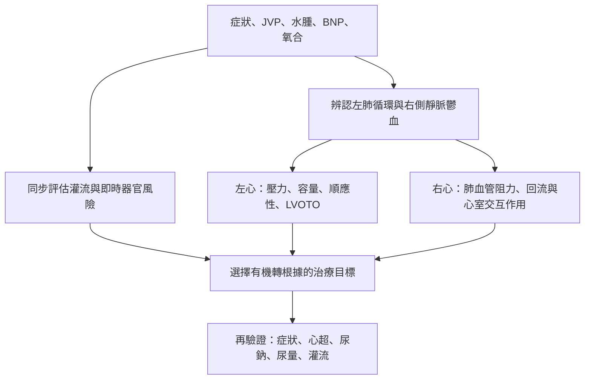

# 呼吸困難合併水腫，為什麼治療方向可能相反？

72 歲男性因 COPD 急性惡化合併肺炎就醫，有呼吸困難、頸靜脈怒張、雙腿水腫及冰冷濕黏皮膚，pro-BNP 2,515 pg/mL。這容易令人把「水腫、喘、BNP 高」直接等同於心因性肺水腫。然而胸部 CT 主要顯示肺炎及肺氣腫，**不是已證實的 cardiogenic pulmonary edema**。心超顯示 LVEDD 37 mm、EF 約 80%、SAM 及 peak LVOT gradient 98 mmHg；RV 未擴大，沒有 overt cor pulmonale。〔[Kim et al. 2015：原始病例及 Figures 1–3](https://jtd.amegroups.org/article/view/5226/html)〕

**這是反例，不是一般急性失代償 HF 的典型治療病例。**它說明周邊水腫、左室充盈、灌流與心因性肺鬱血不可彼此推定。以下會將這個病例的反向診斷推理，與另一條真正有 cardiogenic pulmonary congestion、應評估去鬱血的路徑並排，避免以單一病人的治療反應推導所有 HF 的用藥規則。

## 第零步：確認呼吸困難是否真的來自肺循環鬱血

原病例的 CT 異常是肺炎，不能因為肺部聽到 rales 便在原始資料之外補上心因性肺水腫。另一些真正有肺鬱血的病人，肺靜脈壓升高也可能主要來自血液重新分布，而非全身大量增加鈉水。**先辨認病因與鬱血部位，再問造成該壓力的機轉。**

我們很容易把 heart failure 連成一條自然史：心肌收縮變差，EF 下降，血液無法打出去，接著水分累積，最後肺水腫。這個模型可以解釋一些病人，卻把四個不同的問題混成同一個結論：心臟是什麼疾病、實際輸出夠不夠、上游壓力高不高，以及當前體液總量是否增加。

[〈Heart Failure：從四象限到診斷與急性失衡〉](../xiaoma-reading/originals/2026-07-12-heart-failure.md)先將 congestion 與 perfusion 拆成兩條軸。病人可以 wet-warm，表示已有充盈壓負擔但暫時維持灌流；也可以 wet-cold，同時有上游壓力與低灌流。這個四象限是當下的血流動力學狀態，不是 HF 的病因、EF 分類，也不是從 Stage A 排到 Stage D 的另一種程度分級。

真正造成肺循環鬱血的近端事件是 pulmonary venous／left atrial pressure 升高。但 filling pressure 上升不必然表示全身已經累積同等比例的鈉水。除了真正的 volume accumulation，血液從周邊血管床重新分配到中央循環，也可能使壓力迅速升高。單靠「肺水腫」一個結果，還不知道病人最需要改變的是總體液、血液分布、心臟充盈條件，還是已經無法維持的器官灌流。

因此，在討論利尿是否不夠以前，我們還需要先回答更前面的問題：這個壓力究竟是怎樣產生的？

### 從觀察到決策：必須逐層建立、不能直接跳躍

*圖：本篇依據生理與指南自行整理的推理架構，**並非 Pocket Medicine 原圖**。同一個病人可以同時存在左右心不同的充盈狀態；每一步都需要相應證據。*

## 重新閱讀 Pocket Medicine 的兩張不同的圖：分類與機轉不是同一件事

這裡需要直接回到《Pocket Medicine》第九版原始 PDF，而不只採用文章中流傳的示意圖。**PDF 物理頁 37 的四象限圖**，橫向問有無 congestion，縱向問有無 low perfusion，給出 warm/dry、warm/wet、cold/dry、cold/wet 四種當下的床邊 profile；**物理頁 35 的 Figure 1-2** 卻回答另一個問題：同樣是 left-sided HF，為何在 LVEDP 升高時，LVEDV 可以升高，也可能並未升高？後者從 systolic dysfunction、high stroke-volume states、diastolic dysfunction 與 pericardial constraint 拆開機轉。不能拿後者冒充四象限原圖，更不能把前者當成四條不同病因的診斷演算法。

原書四象限在每格旁邊放入簡短治療方向，例如 cold/dry 對應 inotropes、warm/wet 對應 diuresis。**這是壓縮的管理提示，不是只看所在格就能開立處方的充分條件。** 臨床上的「dry」代表目前沒有明顯可辨識的 congestion，不保證左室充盈足夠；「cold」是灌流不足的床邊假說，還必須辨認是否確有流量不足及其機轉。因此，cold/dry 病人若同時有低前負荷、動態阻塞、右室限制或其他可逆原因，不能僅從分類名稱推論需要正性肌力藥。這也解釋為何同時存在周邊水腫與 preload-sensitive LVOTO 的病例，必須重新檢查「濕」所指的部位及循環後果。患者冰冷濕黏的皮膚提供灌流警訊，卻沒有直接量測 cardiac output 或侵入性 hemodynamics，不能自行宣稱已確診 cold-wet cardiogenic shock。

原書物理頁 34 的 tailored therapy 段落另把 LVEDV、LVEDP、LAP 與 PCWP 作為近似的 preload 指標連在一起。這句高度壓縮的床邊捷徑也要拆解：**LVEDV 是容積，LVEDP／LAP／PCWP 是壓力，量綱不同，不可能直接視為彼此數值相等。** 即使不同壓力之間在特定條件下可能相關，也必須檢查舒張期壓力傳遞、二尖瓣／左心房或肺靜脈病變、心室順應性及外在限制。Figure 1-2 正好從機轉上反證「壓力一高就是容積過多」的過度推論。

**圖表出處：**《Pocket Medicine》第九版 PDF 物理頁 35（left-sided HF 病因流程）及 37（congestion × perfusion 四象限）。原書原圖未在此重製；上方流程與表格均為本篇新整理。原圖用途不同，不能互相替代。

### 同一個臨床發現，究竟在回答哪一層問題？

| 臨床觀察 | 直接支持的判斷 | 尚不能直接推論 |
|---|---|---|
| 肺水腫或 JVP 升高 | 有肺循環或全身靜脈鬱血的線索 | LVEDV 一定升高、全身總水量必定過多 |
| 四肢冰冷、少尿、意識改變 | 應評估器官灌流不足 | 必定是 HFrEF 或特定心輸出數值 |
| LVEF preserved 或降低 | 心室射出比例及其變化 | 當下 systemic flow、LV filling pressure 或病因 |
| 單次利尿後 urine sodium／尿量增加 | 此劑在特定時間窗已產生腎臟反應 | 全日已達負鈉平衡、鬱血已解除 |
| Creatinine 上升 | 腎功能指標出現變化，需要重新判讀 | 一定是過度利尿，或必須無條件停止去鬱血 |

這張表是依據四篇原稿建立的**整合判斷表**，不是 Pocket Medicine 的原表。它的用途是防止從一項 observation 跨過中間的機轉與適用條件，直接跳到治療結論。

## 左心 filling pressure 升高，不等於所有左心室都已經裝得過滿

[〈從四象限走進 LVEDP〉](../xiaoma-reading/originals/2026-07-12-lvedp.md)追問的是同一個 pulmonary congestion 背後的 pressure–volume mechanism。它先提醒我們，肺靜脈壓與左心房壓才是肺水腫較直接的上游變項；在沒有顯著 mitral／left atrial／pulmonary venous pathology 妨礙壓力傳遞時，才較適合用 LV filling pressure／LVEDP 解釋。

即使已經知道 LVEDP 上升，仍不能直接推論 LVEDV 一定增加。心室可能因為收縮後殘餘容量增加，使下一次充盈的起點不斷提高；也可能因為 compliance 下降，即使裝進的血量不多，壓力卻已經非常高。心包限制又是另一種外部約束。相同的「高壓」，沒有保證相同的容量，也沒有保證相同的處置優先順序。

這個區分也回應了 [HCM 原稿〈Nonobstructive 只回答了一個問題〉](../xiaoma-reading/originals/2026-07-14-hcm.md)。沒有 LVOTO，不能證明 filling 沒問題；EF preserved，不能證明 LVEDP 正常，也不能證明 stroke volume 充足。HCM 的 morphology、outflow、filling、contraction 與 electrical risk 本來就不是同一條強度軸。當不同病人出現相似肺水腫時，不能只因 EF、LVOTO 或心臟大小不同，就預先決定誰有真正的 congestion。

### 回到病例：同樣的水腫，為何負荷條件一改，病情就逆轉？

Kim 等人在 2015 年的病例中，除了 LVEDD 37 mm、EF 約 80% 與 LVOTO gradient 98 mmHg，心超還看見 SAM 與典型 late-peaking Doppler。**這證明的是特定時間點的動態流出道阻塞，不證明 HCM，更沒有測到 LVEDP、PCWP 或 cardiac output。**其可能的機轉包括 COPD 惡化時肺血管阻力、肺過度充氣及心室交互作用改變，使左室充盈進一步受限；這是作者提出的生理解釋，而不是每一步都經侵入性壓力測量證實。〔[原始 Figure 2：SAM、color Doppler 與 late-peaking CW Doppler](https://pmc.ncbi.nlm.nih.gov/articles/PMC4598527/)〕

| 病程節點 | 真正觀察到的事 | 推論可以走到哪裡 |
|---|---|---|
| 到院 | CT 顯示肺炎／肺氣腫，呼吸困難、JVD、腿腫、冰冷濕黏皮膚，pro-BNP 2,515 | 具有肺病與靜脈／灌流異常線索；**未證實 cardiogenic pulmonary edema** |
| 初次心超 | 小 LV、EF 高、SAM、LVOT gradient 98 mmHg；RV 未擴大、無 overt cor pulmonale | 動態 LVOTO 成立；**不等於結構性 HCM，也不能推定 LVEDP、PCWP、CO 或明確右心衰竭** |
| 針對肺病與負荷調整後 | 感染治療、beta-blocker 與審慎補充容量；SAM／LVOTO 消失、pro-BNP 降低 | 連續影像與病程支持 preload-sensitive obstruction 的解釋；**同時治療多項因素，不能把改善完全歸因單一操作** |
| 後續因腿腫使用 torsemide 10 mg/day | 兩日後呼吸困難再惡化，SAM／LVOTO 復現；停用利尿並審慎調整液體後改善 | 提供再次挑戰的時間序證據；**不能把單一病例變成所有 HF 禁用利尿的通則** |

這個例子恰好說明：**外周靜脈鬱血徵象，不能替左室前負荷、肺靜脈壓與流出道幾何狀態作證。**如果把四象限簡單當成用藥表，會錯過這個足以翻轉治療方向的事實。病例本身也不能倒推患者曾有何種確切左心充盈壓，沒有測量就應保留未知。

當這些差異被保留，下一個問題才變得精確：如果當前主要限制確實是需要解除的 congestion，利尿劑究竟應該改變什麼？

## 同樣是「仍然 wet」，可能是三個截然不同的治療狀態

[〈利尿效果不夠，為什麼下一步不一定是加量？〉](../xiaoma-reading/originals/2026-07-20-diuretics.md)把「利尿效果不足」拆成幾種不能互相替代的狀態。

第一種是這一劑藥尚未有效抵達作用位置。Loop diuretics 並非只要吞下去就會作用在 NKCC2；它們需要進入腎小管管腔，達到足夠曝露以跨過 natriuretic threshold。若沒有早期反應，問題可能在吸收、藥物送達、管腔濃度或腎功能相關的 dose–response 位移。此時討論增加有效曝露，與宣稱腎臟已經「對利尿劑失去反應」，不是同一件事。

第二種是每一劑明明產生 natriuresis，卻未能在全天累積成足夠負鈉平衡。藥效消退後的 sodium reabsorption、給藥時間分布與下游 nephron compensation，可能把早期效果部分抵銷。這時重新安排有效作用時間，或在確有必要時處理遠端鈉回收，並非單純尋找「更強的下一顆藥」。

第三種是藥物已經有效、負鈉平衡也逐漸形成，但病人仍有殘餘 congestion。這不等於前面兩種 failure。早期 urine sodium／urine output 回答單次劑量是否開始作用，daily weight 與較長時間的淨平衡較接近累積效果，而 JVP、肺循環／全身靜脈鬱血徵象和症狀才讓人重新判斷目標是否達成。把所有結果縮成「尿多不多」，就無法區分該維持、調整還是終止某種處置。

不只是「有沒有排尿」，連 creatinine 也不能脫離這條病程解讀。去充血過程中的變化，與同時出現 hypotension、progressive oliguria 或 systemic hypoperfusion 的變化，承接不同的上游條件。數值本身不能回答下一步是否繼續去充血；它必須回到當前 congestion、perfusion 與治療反應的組合。

## 生理推理如何真正約束處置？

### 相同症狀，兩條不能混同的臨床路徑

| 必須回答的問題 | A：Kim 2015 真實 LVOTO 病例 | B：假設已確認的急性失代償 HF |
|---|---|---|
| 喘的主要證據 | COPD／肺炎與動態 LVOTO，不能把 CT 當成已確認的心因性肺水腫 | 假設 lung ultrasound／心超等支持 cardiogenic pulmonary congestion |
| 鬱血與充盈 | JVD、腿腫不能直接決定 LVEDV、LVEDP 或 PCWP | 左心高充盈壓成立，仍要區分總鈉水累積與血液重新分布 |
| 哪個機轉改變處置？ | preload-sensitive SAM／LVOTO、肺病及負荷條件 | 去鬱血適應症、灌流狀態、缺血或瓣膜等誘發因素 |
| 如何驗證治療？ | 重新檢查 SAM／LVOT Doppler、症狀與器官灌流 | 肺鬱血、尿鈉與尿量、總鈉水平衡及器官灌流的變化 |

**B 是明確標示的假設情境，不是另一篇 case report，也沒有替它虛構血壓、LVEDP 或結局。**A 要防止把所有水腫都當成肺鬱血；B 才是下列尿鈉導引去鬱血建議真正適用的情境。前者的個別治療反應不能推翻後者的適應症。

**先問「這個病人是否適用去鬱血路徑」，再問「利尿劑作用是否足夠」。** 若有持續肺鬱血、臨床證據支持 volume overload，且沒有尚未處理的低灌流或動態阻塞，靜脈 loop diuretic 是住院急性失代償 HF 的核心去鬱血治療；但若顯示的是小左室合併 SAM／LVOTO、可能的右心側負荷與左心 underfilling，機轉已經不同，不能沿用「看到水腫就加量」的慣性。兩條路徑不能用同一個 BNP 或單次 EF 取代血流動力學評估。〔[2022 AHA/ACC/HFSA HF guideline：Section 9](https://www.jacc.org/doi/10.1016/j.jacc.2021.12.012)；[2026 ESC HF guideline：Section 7.5](https://academic.oup.com/eurheartj/article/47/38/5346/8766302)〕

| 目前的主導問題 | 先核對的證據 | 需要驗證的治療方向 |
|---|---|---|
| 明確左心／肺鬱血，灌流尚可 | JVP、lung US／CXR、血壓與末梢灌流、腎功能；必要時心超 | 去鬱血是否減輕呼吸困難與充盈壓負擔；同時監測鈉水排泄及安全性 |
| 肺鬱血伴低灌流／shock 風險 | 四肢灌流、意識、尿量、乳酸趨勢、心超與病因；必要時進階血流動力學 | 不能只追求負平衡，須同步處理造成低輸出的機轉及器官支持需求 |
| 周邊水腫，但 LV 小且有 SAM／LVOTO | LVOT Doppler、SAM、左室大小、右心負荷與負荷條件變化 | 重估減少前負荷／後負荷的風險，針對阻塞與合併肺病作病人特異處置 |
| 「利尿效果差」，但尚未確定主要問題是 congestion | 與給藥時間對照的尿鈉、尿量、24 小時淨平衡、體重與鬱血徵象 | 先辨認藥效曝露不足、補償性鈉回收或治療目標錯誤，而非把加量當預設答案 |

這張表不是開立藥物、輸液或升壓劑的自動指令；病人可能同時落入多種問題，緊急呼吸衰竭、惡化灌流與急性冠脈症候群等需要同時處理。**真實決策從不只取決於 profile 的名稱，而取決於介入前的條件與介入後能否被證偽。**

### 有 indication 進行去鬱血時，還要區分三種「效果」

2026 ESC HF 指引 Section 7.5.3 提到：對接受 IV loop diuretic 的急性失代償 HF 病人，可在給藥後約 2 小時觀察 spot urinary sodium（例如 ≥70 mEq/L），或在最初 6 小時評估尿量（例如 ≥100 mL/h），作為**早期利尿反應**的實務指標。這些是特定情境的操作參考，不是 HF 診斷條件，更**不適用於尚未確認是否該去鬱血的 LVOTO 病例**。尿鈉濃度與尿量也不等於當日排出的總鈉量；真正的 natriuresis 還要考慮尿量及時間窗。〔[2026 ESC 原始指引 Figure 15](https://academic.oup.com/eurheartj/article/47/38/5346/8766302)〕

接下來必須再問：整天是否真正形成所需的負鈉平衡？第三問才是肺鬱血、JVP、症狀、體重與器官灌流是否朝目標改善。2026 ESC 將 urinary Na⁺-guided 策略列為 **Class IIb、Level B**，可考慮用來改善短期 natriuresis 與 diuresis。PUSH-AHF、ENACT-HF 等研究觀察到排鈉反應改善，但截至該指引，**尚未證明能降低死亡或 HF 再住院**。把「2 小時尿鈉達標」直接寫成「病人已去鬱血／預後改善」，是把生物標記的時間尺度誤當成臨床終點。

最後需要對照反例：若另一位病人已有明確肺鬱血、左心充盈壓升高、**沒有** SAM／LVOTO，且仍有去鬱血適應症，本病例並不能否定他接受適當 loop diuretic 的必要性。反之，若治療中呼吸窘迫加劇、四肢變冷、尿量驟降或血壓惡化，就不能只追逐更大尿量。creatinine 小幅上升也不能脫離去鬱血成效與灌流一起判讀；2026 ESC 特別提醒，達成去鬱血時短暫、輕微的肌酸酐上升，不等於治療必然有害。〔[2026 ESC HF guideline](https://academic.oup.com/eurheartj/article/47/38/5346/8766302)〕

## 什麼時候問題已經不再是利尿強度，而是器官能否繼續承受？

假如病人仍有 pulmonary congestion，但呼吸工作快速增加、氧合支持不足，這時不能把正在發生的 respiratory failure 當成等下一次利尿作用即可解決的「水腫還沒消」。需要評估當下可接受的氧合與通氣支持，同時處理使肺循環壓力升高的機轉。反過來，若病人出現低血壓、四肢冰冷、意識或腎灌流惡化，也不能一面把所有不足都歸於「利尿不夠」，一面繼續只追求更大的淨輸出。

原來四象限中的 warm／cold，到了這裡不再只是分類名稱，而是直接提醒：同樣要處理 congestion，病人能承受的 hemodynamic intervention 未必相同。更高的尿量未必等於器官得到更多血流；血壓回升也不能自動證明流量與組織灌流已經恢復。需要重症監測或器官支持時，改變的是整個照護目標與回饋證據，而不是把同一顆藥加到更高劑量。

這也是為什麼重症視角應出現在此處，而不是文章最後另加一份「ICU 用藥整理」。它接續的是原本尚未解決的問題：病人是否仍需要去充血？在繼續去充血時，他是否還能維持呼吸、循環與腎灌流？若不能，現在最危險、最應先處理的 failure mode 是什麼？

這些判斷必須由臨床資料決定。具體 respiratory support、vasoactive support 與 shock-directed treatment 的適應條件，仍需根據患者實際情況和現行專科證據另外核對；不能單靠這篇跨文整合稿形成處方。

## 從四篇文章回到同一個臨床問題

HF 四象限告訴我們：病人此刻是否 congested、是否 hypoperfused。LVEDP 一文告訴我們：同樣的 left-sided congestion，可以由不同的 pressure–volume mechanism 形成。HCM 一文提醒我們：EF、LVOTO、filling 與 forward output 的結論不能彼此替代。Diuretics 一文則從治療反應逆向拆出：單次曝露、全天負鈉平衡與真正解除 congestion，是三個不同的判斷時點。

這裡真正建立的不是「HF 文章讀完再讀 LVEDP 再讀利尿劑」的目錄順序，而是一個可以來回驗證的模型。

看到 pulmonary congestion，先辨認壓力與灌流的狀態；看到高 filling pressure，仍需追問它對應的容量與順應性；看到利尿反應，必須區分藥物命中、累積效果與臨床終點；當呼吸或灌流無法再被代償時，必須改變當前治療優先順序與監測密度。每往下一步，改變的不是術語，而是目前哪一層未知已經足以支配行動。

**核心結論：沒有哪一個 EF、LVEDP、urine output 或 creatinine 可以獨自代表 HF 病人的完整狀態。真正能改變治療的是這些訊號在同一段病程中，分別證明了什麼、仍然沒有證明什麼。**

---

**延伸閱讀與文獻：**[HF 原稿](../xiaoma-reading/originals/2026-07-12-heart-failure.md) · [LVEDP 原稿](../xiaoma-reading/originals/2026-07-12-lvedp.md) · [Diuretics 原稿](../xiaoma-reading/originals/2026-07-20-diuretics.md) · [HCM 原稿](../xiaoma-reading/originals/2026-07-14-hcm.md) · [Kim 2015 原病例與圖](https://jtd.amegroups.org/article/view/5226/html) · [2022 AHA/ACC/HFSA 指引](https://www.jacc.org/doi/10.1016/j.jacc.2021.12.012) · [2026 ESC 指引](https://academic.oup.com/eurheartj/article/47/38/5346/8766302)。本文是獨立的 AI 跨篇整合教材，保留作者原稿；引用的新指引僅核對本文相關章節，並不代表全篇已通過獨立臨床審查。