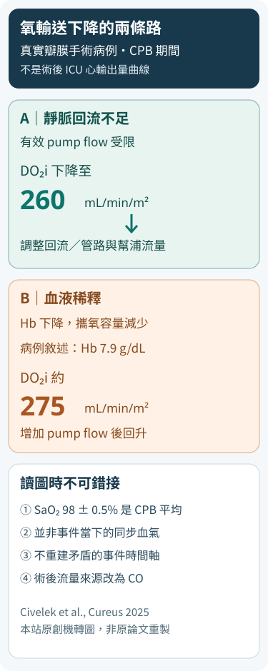

# 血氧看起來不差，DO₂i 為什麼仍下降？從 CPB 到心臟術後的 Hb × CO

2026.10.27｜Clinical OS・CTICU ABG × oxygen transport

第一篇 CABG 乳酸與 ScvO₂ 告訴我們：即使有乳酸和靜脈氧飽和度，也不能單獨回答灌流是否足夠。接下來有個更早發生、也更容易被忽略的問題：**氧已經進入動脈血，為什麼仍可能沒有足夠氧送達組織？**

這次不要從公式開始。先看一位真實病人的手術過程。

## 第零問｜SaO₂ 看起來不差，哪個變化不能等到 lactate 上升才處理？

Civelek 等人在 2025 年 12 月發表一名 **61 歲、125 kg、BSA 2.23 m²** 女性的病例。她接受再次開胸的 **mitral valve replacement 與 tricuspid repair**，心肺繞道（cardiopulmonary bypass, CPB）持續 156 分鐘，主動脈夾閉 113 分鐘。這不是 CABG，也不是第一篇 69 歲男性的後續病程。

這個病例特殊之處是團隊連續追蹤 **indexed oxygen delivery（DO₂i）**，不只看血壓或動脈氧飽和度。原文 Table 2 的 CPB 整體摘要報告 **SaO₂ 98 ± 0.5%、PaO₂ 230 ± 25 mmHg、pump flow 5.4 ± 0.25 L/min、DO₂i 295 ± 10 mL/min/m²、SvO₂ 76 ± 2%**。請注意：**這些是整段 CPB 的摘要值，不是同一秒鐘的一組血氣。**

原文敘述兩個不同的氧輸送下降事件。第一個事件發生在 CPB 約 20 分鐘：DO₂i 下降到 **260 mL/min/m²**，作者認為與靜脈回流不佳有關，團隊調整管路／回流與 pump flow 後，DO₂i 回升至約 **290–300**。第二個事件是 **hemodilution**：敘述中 Hb 下降到 **7.9 g/dL**，DO₂i 約 **275**，增加 pump flow 後回升至 **310–320**。這些數字是**作者對事件的敘述**，不能與 Table 2 的整段平均 SaO₂ 任意拼成「最低點同步 SaO₂ 98%」。

對值班醫師而言，這個故事的核心不是背下 280 或 300 的 CPB 門檻，而是看見**同一個 DO₂ 下降，可以來自流量不足，也可以來自每單位血液攜氧量下降；兩者的可逆原因與處置不相同。**

<figure id="cticu-do2-two-paths" style="margin:1.6rem auto;max-width:375px">

<figcaption>圖 1｜同一個 DO₂i 下降，分別可能由流量與血紅素容量驅動。依 Civelek 等人 2025 年病例**文字事件**重新設計的本站原創示意圖，**不是原論文圖表的轉描**；兩個事件沒有可公開重建的同步 SaO₂，圖不使用未定義的時間軸。原始論文的時間長度自相矛盾，不能由本圖解決。</figcaption>
</figure>

而且要先守住時間界線：這位病人的兩次事件發生在 **CPB 期間，流量由幫浦決定**；病人離開 CPB 進入 ICU 後，循環流量改由心臟、節律、前後負荷與必要的機械支持決定。不能把 CPB 的 pump flow 或 DO₂i 數字直接當成術後的 cardiac output 目標。

## 第一問｜SpO₂、SaO₂、PaO₂、CaO₂ 究竟哪一個是在描述「氧的數量」？

**SpO₂** 是 pulse oximeter 估計的周邊動脈血紅素氧飽和度。**SaO₂** 是動脈血紅素氧飽和度，若以 co-oximetry 測得，較能區分不同 Hb 物種；單純由血氣機器依 PaO₂ 計算的「SaO₂」仍可能有誤差。**PaO₂** 是動脈血漿中溶解氧形成的分壓，主要回答肺泡與動脈之間的氧合結果。它們都不直接告訴你血液總共帶了多少氧。

真正描述每 **100 mL 血液**攜帶氧量的是 **CaO₂（arterial oxygen content）**：

**CaO₂（mL O₂/dL）≈ 1.34 × Hb（g/dL）× SaO₂（0–1）＋ 0.003 × PaO₂（mmHg）**。

第一項是與 Hb 結合的氧，第二項是血漿溶解氧。正常情況下第一項遠大於第二項。因此 SaO₂ 接近 100% 只表示**現有 Hb 的結合位點幾乎被氧占滿**，不代表 Hb 數量足夠。

例如以下只是**教學反事實，不是上述患者實測**：假設兩個時點 SaO₂ 都是 98%、PaO₂ 都是 100 mmHg。Hb 10 g/dL 時 CaO₂ ≈ **13.43 mL/dL**；Hb 7 g/dL 時 CaO₂ ≈ **9.49 mL/dL**。血氧飽和度完全不變，每 100 mL 血液所帶的氧卻減少約 **29%**。若 Hb 7、SaO₂ 已 98%，把 PaO₂ 從 100 提到 300 mmHg、暫時假設飽和度不變，溶解氧項只增加約 **0.60 mL/dL**，無法把 Hb 缺口完全補回來。這是數學比較，不是要用高 FiO₂ 治療貧血。

因此 **SpO₂ 100% ≠ CaO₂ 正常**。反過來說，Hb 正常也不代表氧輸送已足夠；我們還沒有把血流量算進去。

## 第二問｜CaO₂ 正常，為什麼低 cardiac output 仍可能使組織缺氧？

**DO₂（oxygen delivery）**是**每分鐘**送往全身循環的氧量，近似：

**DO₂（mL O₂/min）= CO（L/min）× CaO₂（mL/dL）× 10（dL/L）**。

**DO₂i = DO₂ / BSA**，單位 mL/min/m²。若正在 CPB，計算用的流量是 **pump flow**；離開 CPB 後，才回到病人的 systemic cardiac output（或特定機械支持情境下的總系統血流）。同一個字母 Q，在兩個階段代表不同的流量來源。

沿用上一段**教學反事實**，假設 Hb 10、SaO₂ 98%、PaO₂ 100，CaO₂ 13.43 mL/dL：
- CO 4 L/min 時，DO₂ 約 **537 mL/min**。
- CO 降為 2 L/min，其他完全不變，DO₂ 約 **269 mL/min**。
- 若 CO 仍是 4 L/min，但 Hb 降為 7 g/dL，DO₂ 約 **380 mL/min**。

這三個情境可以擁有幾乎相同的 SpO₂。第一個是參照情境；第二個主要是**流量問題**；第三個主要是**攜氧容量問題**。處置前要先知道是哪一條路出錯，而不是一律增加 FiO₂、輸液、輸血或加強心藥。

**VO₂（oxygen consumption）**是組織每分鐘真正消耗的氧；**oxygen extraction ratio（O₂ER）**是 VO₂/DO₂。當 DO₂ 下降，組織可能增加氧萃取來暫時維持 VO₂，但這種代償有上限，而且器官間不均勻。**SvO₂** 是肺動脈取得的混合靜脈氧飽和度，反映全身氧供需關係的綜合結果之一；**ScvO₂** 是中心靜脈抽樣，不能與 SvO₂ 互換。SvO₂ 很高也不能證明所有微循環都得到足夠氧。

這裡與《Pocket Medicine》第九版的 **PA catheter and tailored therapy**（讀者 PDF p31–33，尤其 p32 的 Fick 方法）接起來：Fick 關係使用**氧耗與動靜脈氧含量差**連接 CO。書後公式附錄 PDF p374 也列出以 Hb、SaO₂、mixed venous saturation 表示的近似式。**但公式不等於每位 ICU 病人都需要 PAC**；測量方式、採樣部位與是否真正量到 VO₂，會限制推論。這一段是把原書的 hemodynamic measurement 與本篇氧輸送機制連起來，不重寫既有酸鹼／V/Q 文章。

## 第三問｜病人已經離開 CPB，SpO₂ 100%，值班時到底先分哪一條路？

假設術後 A-line 與 pulse oximeter 都顯示氧合不差，但病人越來越需要 vasopressor、尿量下降或四肢灌流變差。此時不能只追 PaO₂，也不能只憑 Hb 數字決定輸血。第一件事是找出**需要立刻處理的外科或循環問題**：胸管流量與是否突然阻塞、持續出血、心包／縱膈壓迫、心律與 pacing、低心輸出、右心衰竭、瓣膜／冠脈問題、血管擴張及器官灌流徵象。血壓在 pressor 支持下正常，不排除低流量。

接著把資料按時間配對：**CBC 的 Hb/Hct 趨勢、ABG 的 PaO₂／實測 SaO₂、lactate、A-line、echo／CO、尿量、皮膚與神智**。若沒有同步 CO，不能由 SpO₂ + Hb「算出」病人的實際 DO₂；若 Hb 下降，先辨認 hemodilution、持續出血與採血時點，不把濃度變化直接等同於血液總量流失。

**流量分支**：如果 echo 顯示心室功能惡化、RV 擴大、局部壓迫或節律造成低 CO，優先辨認可逆原因並與心外科／ICU 團隊處理。這不是「低 DO₂ → 一定加液體」；有些病人需要止血或解除壓迫，有些需要調整 pacing、afterload、inotropy 或機械支持。大量輸液可能加重右心壓力、肺水腫或血液稀釋。

**攜氧分支**：若 Hb 降低但病人穩定，輸血不是由 CaO₂ 公式自動決定。這裡另有一份**真正來自術後 CVICU、而非 CPB 個案**的資料可以補足判斷，但它是群體觀察，不能拼接成上面那位女性的術後數值。

2026 年 Okamoto 等人於 *Critical Care* 發表單中心回溯研究：**1,352 位心血管手術 ICU 病人**在 Hb ≥7.5 g/dL 時接受一個標準日本 2-unit RBC product（約等於國際常用的一單位 packed RBC），並有輸血前後的肺動脈 **SvO₂**。群體平均 Hb 由 **9.82 ± 0.92 增至 10.24 ± 0.98 g/dL**，平均 SvO₂ 卻由 **73.79 ± 9.91% 至 73.86 ± 9.37%**，配對差 **0.08 個百分點**（95% CI −0.28 至 0.43，P=0.671）。個別病人的變化差異很大；輸血前 SvO₂ 較低者，較可能出現 SvO₂ 上升。這不是「輸血無效」的證明，更不是「SvO₂ 低就該輸血」：回溯研究有適應症偏差、其他同期治療與 CO 變化，**沒有證實器官氧合或病人結局改善**；作者的探索性 69% 分界**不得作為輸血門檻**。

**TRICS III** 在中高風險成人心臟手術比較 Hb <7.5 g/dL 的 restrictive strategy 與較高門檻策略，主要複合臨床結果符合非劣性；**2023 AABB** 對血流動力穩定的心臟手術患者允許採用 7.5 g/dL 作為考慮輸血的門檻；**2024 EACTS/EACTAIC/EBCP PBM guideline** 強調依出血、缺血、灌流與個體風險調整。**這些不是活動性大出血、急性心肌缺血或不穩定 shock 病人的一條固定禁令。**

**氧耗分支**：發燒、疼痛、寒顫、呼吸功增加、躁動等可能提高 VO₂。即使 DO₂ 暫時沒有下降，供需比仍可能惡化；治療需要同時考慮供氧與耗氧，不是每個病人都靠增加輸血量解決。

最後要回到器官：灌流改善了嗎？尿量、皮膚、神智、乳酸趨勢、血流動力與支持需求是否一致？**DO₂ 是送出的氧，不是每個器官都已利用的氧。** 單一「好看的」SpO₂、SvO₂ 或 CO 都不能代替病人整體的再評估。

## 反事實｜哪個改變會真正改變決策？

**情境 A：SaO₂ 98% → 100%，Hb 7、CO 2，其他不變。** 血氧飽和度上升很小，無法取代對貧血與低流量原因的評估。

**情境 B：SaO₂ 98% 不變，Hb 7 → 10，但 CO 因心包壓迫下降。** CaO₂ 增加，DO₂ 卻未必改善；若是 tamponade，輸血不是解除阻塞的替代方案。

**情境 C：SaO₂、Hb 都不變，CO 恢復。** DO₂ 可以大幅上升；但如果局部微循環障礙仍在，不能僅以 DO₂ 回升宣告所有器官安全。

**情境 D：Hb 7.8，病人穩定、無進行性出血／缺血；與 Hb 7.8 且持續胸管出血、pressor 快速增加。** 同一 Hb，臨床風險與輸血／外科評估的優先序不同。不能將 restrictive trial 的「平均策略」機械化成急性出血病人的指令。

## 為什麼這個病例不能證明 280–300 是術後治療門檻？

本病例是在約 30°C 的 CPB 中觀察氧輸送變化，並涉及體溫校正與非校正的 DO₂i 表示。2024 EACTS/EACTAIC/EBCP CPB guideline 對**常溫 CPB**的 280–300 mL/min/m² 建議，不可直接拿來判定這名低溫 CPB 病人每個瞬間是否已發生組織缺氧，更不能外推為離開 CPB 後的 ICU 輸血、補液或強心劑啟動值。

單一病例在調整靜脈回流、pump flow 後 DO₂i 上升，只能支持「流量與攜氧容量會共同決定計算出的氧輸送」這個生理關係；它不能證明某項介入改善了腎功能、死亡率或微循環，也不能把未出現 AKI 反推成每次 DO₂i 下降都安全。原文 heparin 初始劑量的敘述與 Table 4（300 IU/kg vs 400 U/kg）另有不一致，作為來源忠實度警示，而非本篇氧輸送治療依據。

## 這篇不能越過的資料邊界

這份 2025 個案的 **Table 2 是 CPB 平均數**；敘述中的 DO₂i 260、275 與 Hb 7.9 是事件值，**不能當作同一時點的配對檢體**。Table 3 術後 12 小時報告 Hb **9.7 g/dL**、PaO₂ **99.4 mmHg**、pH **7.38**，但沒有同時提供術後 CO、SvO₂、實測 SaO₂；因此**不能算出這位病人術後 12 小時的 CaO₂/DO₂，也不能宣稱當時組織缺氧**。論文記載術後血流動力穩定、兩小時拔管，沒有 AKI；不應把 CPB 短暫 DO₂i 下降寫成術後低輸送性 shock。

更重要的是原文存在尚待釐清的**內部不一致**：敘述稱 DO₂i <280 持續 8.5 分鐘，卻又稱低於 300 的時間少於 5 分鐘；兩者在相同時間定義下不可能同時成立。敘述中 CPB 起始 Hb 8.2、後來 7.9，與 Table 3 的「CPB (Pump)」Hb 10.4 也無法僅靠公開資訊確認是否同時點。本文**不引用衝突的持續時間推算缺氧債，也不補造時間序列**。這是來源品質 P1，不能用漂亮的圖掩蓋。

### 參考資料與證據限制

1. Civelek A, Soltanzadeh A, Alizadegan M. *Advanced Metabolic-Guided Perfusion Concepts in an Obese Patient Undergoing Cardiac Surgery: A Case Report.* Cureus. 2025;17:e99447. DOI 10.7759/cureus.99447. [原始期刊頁](https://www.cureus.com/articles/446799-advanced-metabolic-guided-perfusion-concepts-in-an-obese-patient-undergoing-cardiac-surgery-a-case-report)；[期刊 PDF](https://www.cureus.com/articles/446799-advanced-metabolic-guided-perfusion-concepts-in-an-obese-patient-undergoing-cardiac-surgery-a-case-report.pdf)。本文僅使用可確認的表格摘要與病例敘述；原文持續時間及 Hb 採樣時點的不一致，已於上文說明。
2. *Pocket Medicine*, 9E，PA catheter／Fick 與 hemodynamic formulae 相關章節（讀者 PDF p31–33、p373–374）；原書圖表不在本站重製。
3. [2024 EACTS/EACTAIC/EBCP Guidelines on patient blood management in adult cardiac surgery](https://pmc.ncbi.nlm.nih.gov/articles/PMC12257489/)：transfusion triggers 與 Recommendation Table 11；臨床應以原指引全文及註腳為準。
4. Mazer CD et al. [TRICS III](https://pubmed.ncbi.nlm.nih.gov/29130845/). *NEJM*. 2017;377:2133–2144.
5. Carson JL et al. [2023 AABB RBC transfusion guideline](https://doi.org/10.1001/jama.2023.12914). *JAMA*. 2023.
6. [IBCC — postoperative cardiac surgical patients](https://emcrit.org/ibcc/cts/) 與 [Shock & vasoactive medications](https://emcrit.org/ibcc/shock/)：作床邊分流框架，不取代正式輸血指引。
7. Okamoto K et al. [*SvO₂ response to red blood cell transfusion in cardiovascular surgical ICU patients: a retrospective observational study.*](https://link.springer.com/article/10.1186/s13054-026-06149-9) *Critical Care*. 2026;30:341. DOI 10.1186/s13054-026-06149-9。**1,352 名術後 CVICU 病人的群體資料**，不是 2025 個案，亦不能用 69% 作為輸血 trigger。
8. **文獻完整性**：Suttner et al., 2004（PMID 15281492）已撤稿，本文不採用其結果作為證據。

