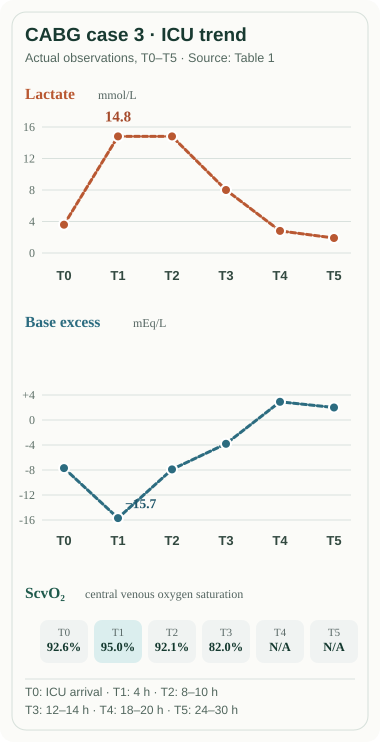

# CABG 術後 lactate 14.8、ScvO₂ 95%：為什麼兩個數字都不能回答灌流是否足夠？

2026.10.26｜Clinical OS・ABG × Cardiothoracic ICU

> **版本：V3 脈絡修訂稿，私人候審，非正式發布。** 這不是第一次成稿；原始 V1（commit `b9f5ee1`）及 V2 保留。文章採用兩份不同的已發表 CABG 病例，數據不得跨病人拼接。原著 Table/Figure 與圖像權利查核、Pocket 9E 原圖、本次獨立醫學審閱及真正手機檢查仍為 HOLD。

術後病人乳酸升高，我們很容易想像一條直線：組織缺氧，轉為無氧代謝，lactate 上升，出現 metabolic acidosis；於是只要看乳酸濃度，就能知道病人的灌流是否足夠。

但這條直線把四個不同問題接成了一件事：**血液現在有多酸？乳酸為什麼升高？循環送出去多少氧？各個組織實際取得與利用了多少氧？**

第一個問題由酸鹼資料回答；第二個需要代謝與病程；第三個需要血紅素及心輸出；第四個則無法由單一全身指標完全確定。

這個區分，在心臟外科 ICU 特別重要。

## 第零問｜剛離開 CPB 的病人循環不穩，現在不能等的是什麼？

2025 年 Wardhana 與 Kurniawaty 發表三名 CABG 病人的術後乳酸病例系列。其中第三名是 **69 歲男性**，術前 LVEF 45%，接受 **108 分鐘 cardiopulmonary bypass（CPB，心肺繞道）**、91 分鐘主動脈夾閉。離開 CPB 後需要 dobutamine、norepinephrine、epinephrine、nitroglycerine；到 ICU 仍不穩定，需暫時性 pacing。

術後 echo 記錄 cardiac output（CO）**5.1 L/min**、cardiac index（CI）**3.1 L/min/m²**、systemic vascular resistance（SVR）**580 dyn·s/cm⁵**。低 SVR 使 vasodilatory physiology 成為重要假說，但病人正在接受多種血流動力藥物；這些數字**不能單獨確診 vasoplegia，也不能排除出血、心室功能失敗或術後局部壓迫**。

到 ICU 四小時，lactate 從 **3.6 上升到 14.8 mmol/L**，central venous oxygen saturation（ScvO₂）卻從 **92.6% 上升到 95%**。

有人可能因此要立刻輸液，因為 lactate 14.8 看起來像嚴重低灌流；也有人可能放心，因為 CI 3.1、ScvO₂ 95% 似乎不支持全身氧供不足。但兩種判斷都跳過眼前更重要的一步。

**CABG 術後需要多種循環藥物、臨床仍不穩定時，首先必須尋找可立即處理的外科與循環危險。** 胸管出血量及趨勢、血壓與 pressor 劑量、有效心律和 pacing、皮膚與四肢灌流、尿量、Hb／凝血及床邊心臟影像，能幫助我們辨認出血、低心輸出、右心衰竭、心包／縱膈壓迫、手術後心肌缺血與血管擴張。不同原因可以共存，處置卻不能互換。尤其疑似持續出血或 tamponade 時，不必等待下一個 lactate 趨勢才開始外科團隊評估與復甦。

這是 IBCC〈Postoperative cardiac surgical patients〉的臨床起點。它不是說不用解釋血氣，而是提醒我們：**病人是否正在失去循環，與我們是否已完整解釋乳酸來源，是兩個不同時限的問題。**

## 第一問｜從 ABG 到 ScvO₂，我們到底量到了什麼？

ABG（arterial blood gas，動脈血氣）直接測量 **pH、PaCO₂、PaO₂**，通常再依 pH 與 PaCO₂ 計算 **HCO₃⁻**；其他項目如 lactate、電解質與氧飽和度，須視儀器及採檢項目。pH 告訴我們酸鹼結果；PaCO₂ 反映 CO₂ 產生與肺泡換氣排除的平衡；PaO₂ 描述動脈氧分壓。**三者無法直接測出心輸出或器官灌流**。

**Base excess（BE）**是血液在標準化條件下的代謝性酸鹼偏移指標。BE 越負，淨代謝性酸化效應越明顯；但 BE 不是 lactate 的另一種寫法，更不是一個可以代替 pH 的直接測量。**Lactate** 表示某一時刻血中乳酸根的濃度，是生成、利用與清除的共同結果。

**ScvO₂**則是中心靜脈導管所採血液的氧飽和度，主要代表該回流範圍的剩餘氧合比例。它不是動脈血的 SaO₂；也不等於由肺動脈取得、混合更廣泛靜脈回流的 **SvO₂（mixed venous oxygen saturation）**。不同採樣位置或時間的數字，不能拼成同一張「完整 ABG」。

第三名 CABG 患者的原文 Table 1 提供 **BE、lactate、ScvO₂、venous–arterial CO₂ gap、glucose** 等時序，卻沒有完整同步的 pH、PaCO₂、PaO₂、HCO₃⁻、Hb、chloride、albumin。這表示我們可以分析他的代謝與靜脈氧合趨勢，**不能替他補造 pH、計算 AG／P/F ratio，或推得他個人的 DO₂**。

在 ICU 最容易犯的錯，往往不是忘記公式，而是把未量到的內容當成已經知道。

## 第二問｜ScvO₂ 95%，為什麼仍不能宣稱 oxygen delivery 足夠？

「動脈血氧合良好」與「每分鐘送到身體的氧足夠」之間，還缺了兩個量。

**CaO₂（arterial oxygen content，動脈血氧含量）**描述每 100 mL 動脈血攜帶多少氧。近似式：

**CaO₂（mL O₂/dL）≈ 1.34 × Hb（g/dL）× SaO₂（0–1）＋ 0.003 × PaO₂（mmHg）**

絕大部分氧由 hemoglobin 攜帶，而不是溶解在血漿裡。因此 SpO₂ 接近 100% 的術後病人，若因 CPB hemodilution 或出血而使 Hb 下降，每單位血液攜帶的氧仍可能減少。

接著，**DO₂（systemic oxygen delivery，系統氧輸送）**還要考慮心臟每分鐘送出多少血：

**DO₂（mL O₂/min）≈ CO（L/min）× CaO₂（mL O₂/dL）× 10**

這裡的 10 只是把 L 轉成 dL。於是我們終於能明白：SaO₂、Hb、CO 是三個不同的資訊。正常 SpO₂ 不能補償 Hb 太低；CI 尚可也不保證病人沒有缺血，尤其當測量是在強心藥和 pacing 支持下完成。

**VO₂（oxygen consumption，氧耗）**則是組織真正消耗的氧。若要藉由動靜脈氧含量差理解**全身**氧耗，理想化 Fick 關係需使用真正代表混合靜脈回流的 **CvO₂**；不能直接把單一 ScvO₂ 當肺動脈混合靜脈數值代入，就宣布已算出全身 oxygen extraction。

ScvO₂ 很高，只表示取樣血液仍高度飽和。它可能與耗氧下降、血流分配改變、某些微循環氧萃取不足或採樣位置有關。它**不是「全身每個器官都足夠氧」的陰性檢驗**。

所以第一名病人的 ScvO₂ 95% 不必和 lactate 14.8「選一個相信」。一個描述特定靜脈血的剩餘氧飽和度，另一個描述代謝產物的濃度；它們**可以同時是真的，也可以同時沒有回答真正的病因**。

## 第三問｜Lactate 與 BE 為什麼甚至可以朝不同方向變化？

細胞即使處在有氧狀態，也持續經 glycolysis 形成 pyruvate，並可透過 lactate dehydrogenase 與 lactate 相互轉換。Lactate 不是缺氧後才突然出現的「廢物」。組織低灌流可能增加 lactate，但 epinephrine 的 β₂ 刺激、術後代謝壓力、CPB 與再灌流等因素也可能促進生成；肝臟等組織的利用及清除改變，則影響血中濃度。**這些不是互斥的 Type A／Type B 箱子。**

原作者認為第三名患者使用 epinephrine 後，乳酸和血糖升高的時間關係支持兒茶酚胺相關機轉。但這是一個**病例作者的可能解釋**，沒有對照實驗足以排除同時存在的缺氧、局部缺血或循環因素。

值得讀的是同一患者的時序，而不是只記最高值。

| ICU 時點 | Lactate（mmol/L） | BE（mEq/L） | ScvO₂ |
|---|---:|---:|---:|
| T0，到院 | 3.6 | −7.69 | 92.6% |
| T1，4 h | **14.8** | **−15.7** | **95.0%** |
| T2，8–10 h | **14.8** | −7.90 | 92.1% |
| T3，12–14 h | 8.0 | −3.8 | 82.0% |
| T4，18–20 h | 2.8 | +2.92 | 未提供 |
| T5，24–30 h | 1.9 | +2.0 | 未提供 |

*表與圖：選自原始 Table 1 第三名病人；T0–T5 並非等間隔，圖為分類時點，不代表均勻的時間軸。原文 Figure 1 出現 Table 1 無定義的 T6，本文不補造 T6。*

注意 **T1 → T2**。Lactate 仍是 **14.8**，但 BE 卻從 **−15.7 改善至 −7.90**。若把乳酸濃度當成整體「酸化程度」，就無法解釋這件事。

BE 受血液中**所有**代謝性酸化與鹼化因素的共同影響，包括 chloride、其他強離子、albumin 及未測陰離子等，當然不必跟 lactate 逐步同步。但來源缺乏同期完整電解質和治療時序，因此**不能宣稱 BE 改善是 bicarbonate、某種液體或單一 chloride 變化造成**。

這個時點的價值不是教我們猜出一個沒有被測量的答案，而是知道：**lactate 上升不等於完整的酸鹼診斷；BE 改善也不等於循環危險已解除。**

## 反過來問｜Lactate 正常，為什麼仍可能出現嚴重代謝性酸血症？

Smyth 等人在 2021 年報告**另一名** 54 歲 CABG 病人，患有 type 2 diabetes，使用 SGLT2 inhibitor dapagliflozin，術前約 24 小時停藥並禁食。

麻醉誘導後 pH 是 **7.45**，但手術後出現逐漸惡化的代謝性酸血症，base deficit 達 **−15.8 mmol/L**。當時的資料包含：

- **Arterial lactate 0.9 mmol/L**；
- **SvO₂ 68%**（注意是 SvO₂，不是前例的 ScvO₂）；
- 血糖 **6.5 mmol/L**；
- **PaCO₂ 2.9 kPa**，有呼吸急促；
- 血中 ketones **4.9 mmol/L**、尿酮 **3+**。

這些數值原本讓人困惑：如果沒有高 lactate、血糖也不高，為什麼會出現明顯的代謝性酸化？

答案來自病史與新的檢驗。禁食、SGLT2 inhibitor 的作用及手術壓力共同促成 **euglycemic diabetic ketoacidosis（euDKA，血糖未顯著升高的酮酸中毒）**。這裡主要需要辨認的酸化來源是 ketones，而不是 lactate。病人經 insulin、dextrose 與電解質／體液管理治療，原文還記載過早撤除治療後再次出現酮酸中毒。

我們不能把第二名病人的完整代謝性酸血症，拿來替第一名填上不存在的 ABG；也不能把第二個病例的低 lactate 推論成「所有 CABG 術後酸中毒都不是低灌流」。

這個對照真正推翻的是：**「酸血症＝乳酸過高」以及「乳酸不高＝沒有重要代謝性酸中毒」這兩個互為鏡像的錯誤。**

若 ABG 指出 HCO₃⁻ 下降或有顯著負 BE，臨床還需要同期 serum Na⁺、Cl⁻、total CO₂／HCO₃⁻、albumin 與相應的 lactate／ketones／腎功能。**Anion gap（AG＝Na⁺−Cl⁻−HCO₃⁻）**能協助辨認未測陰離子；低 albumin 可能掩蓋 AG 增高，因此不能把未校正 AG 的「正常」當作沒有隱藏酸化因素。這裡與既有酸鹼篇連接，不再重寫整套 Winter／delta gap 分類。

## 第三問回到值班｜什麼新證據會真正改變你的判斷？

想像電話報告：「CABG 術後四小時，lactate 14.8，ScvO₂ 95%，仍在 norepinephrine 和 epinephrine。」

現在不應做的，是直接在「一定缺氧，要補大量液體」和「一定是 epinephrine，先不用管」兩個答案中選一個。

更有價值的是先確認**當下是不是循環危機**。若胸管出血急增、血壓下降、升壓藥快速加量，這些新事實會把出血、局部血腫或心功能惡化提高為需立即評估的問題。即使 ScvO₂ 高，仍然不能跳過床邊檢查、回報和必要的外科／心臟超音波評估。術後局限性 tamponade 也可能沒有經典環狀積液表現，影像不典型時不能靠單一陰性徵象結案。

若沒有明顯出血，則應整合心律、pacing、ECG、echo 的 LV/RV 功能、Hb、各式循環支持劑量、尿量及灌流徵象，理解 CI 是在**哪個支持條件**下取得。若懷疑 vasoplegia，低 SVR 是一條線索，但不能只用單一術後數值確診或隨意改變藥物。

最後再回到代謝：同一時間點取得 pH／PaCO₂／PaO₂／FiO₂、electrolytes、albumin、Hb、lactate，必要時 ketones。乳酸的變化必須與循環、呼吸及代謝資料共同追蹤，**不能把 lactate 降低當作已證實處理了出血或 tamponade**。

這個臨床整合不需要假設病房一定有 Swan-Ganz catheter。有 PA catheter 時，CI／SvO₂／PA 壓力可以增加判斷資訊；沒有時仍能從 A-line、胸管、心律、血液檢驗、尿量及 bedside echo 建立可用的臨床模型。**CVP、PAWP 等靜態壓力也不是 fluid responsiveness 的直接證明**，不能因高 lactate 就無目的地反覆輸液。

還有一個容易誤用的數字：2024 年 EACTS/EACTAIC/EBCP 指引提出**常溫 CPB 期間**特定的 goal-directed perfusion／DO₂ 門檻，這些門檻是針對手術中 CPB 的灌流管理，**不能不加區分地轉成離開 CPB 後所有 ICU 病人的固定輸液或升壓目標**。IBCC 的術後 hemodynamic rough targets 也只能和症狀、病程及具體原因一起使用。

## 回到第一個病人

第一例 lactate 14.8、ScvO₂ 95%，其實沒有任何一個數字「錯」。錯的是我們原本希望用單一數字，代替不同層次的生理判斷。

ABG 的 pH、PaCO₂、PaO₂ 描述的是酸鹼、有效換氣與動脈氧合；BE 摘要代謝性酸鹼影響；lactate 是一段生成與清除歷程的濃度結果；ScvO₂ 反映特定回流血液的氧飽和度；Hb 與 CO 則讓我們開始估計氧輸送。它們可以彼此關聯，卻不能相互取代。

第二例正常 lactate、卻有嚴重 euDKA，進一步證明：**辨認是哪一個過程造成血液酸化，不能只盯著 lactate，也不能只從一張 ABG 推定原因。**

到了心臟外科 ICU，血氣真正有價值的時刻，是我們知道**眼前哪個危險必須先處理、哪項新檢查能排除什麼、還有哪個關鍵生理環節尚未被測量**。

下一篇會從反方向繼續：**SpO₂ 已經 100%，為什麼 CABG 術後仍可能有氧輸送危機？** 這時 Hb、CO、CaO₂、DO₂、VO₂ 就不再只是公式，而是直接影響我們如何解釋出血、血液稀釋與低心輸出的臨床模型。

---

## 文獻與原始資料（私有審稿註記；發布須另建來源頁）

1. Wardhana A, Kurniawaty J. *Hyperlactatemia Post-CABG: Case Studies in Three Patients.* *Majalah Anestesia & Critical Care*. 2025;43(3). DOI [10.55497/majanestcricar.v43i3.429](https://doi.org/10.55497/majanestcricar.v43i3.429)；[出版社文章頁](https://macc.perdatin.org/index.php/my-journal/article/view/429)。數值依先前已記錄的出版社原始 Table 1 / Figure 1 私下核對；**本輪重新開啟出版社 PDF 時未能通過網站存取，不能將本輪宣稱為重新完成原始頁面視覺驗收**。需於正式出版再核關鍵欄位與圖表、並保留 Figure 1 T6 疑義。
2. Smyth CC et al. *The catabolic triad: case report of fasting, major cardiac surgery and SGLT2 inhibitors leading to perioperative euglycaemic ketoacidosis.* *Interdisciplinary CardioVascular and Thoracic Surgery*. 2021;33:494–495. [原始全文](https://academic.oup.com/icvts/article/33/3/494/6271397)。pH 7.45 是**麻醉誘導後**值，不是最重酸血症的 pH；不同案例資料不相加。
3. Farkas J. [IBCC: Postoperative cardiac surgical patients](https://emcrit.org/ibcc/cts/), 2025-01-05。專家教材，臨床決策框架非隨機研究結果。
4. Farkas J. [IBCC: Metabolic acid-base disorders & AGMA](https://emcrit.org/ibcc/agma/), 2024-06-29。IBCC uncorrected AG 操作策略與低白蛋白場景的限制須另核對原始 Pocket 9E 與對題指南。
5. Wahba A et al. [2024 EACTS/EACTAIC/EBCP Guidelines on cardiopulmonary bypass in adult cardiac surgery](https://academic.oup.com/ejcts/article/67/2/ezae354/8011475). *EJCTS*, 2025。辨認常溫 CPB 的 DO₂ 特定推薦場景，不外推為所有 CTICU 術後病人的處方。
6. Minton J, Sidebotham D. [Hyperlactatemia and Cardiac Surgery](https://pmc.ncbi.nlm.nih.gov/articles/PMC5347225/). 2017。分辨可能的 hypoxic／nonhypoxic 機轉，並非第一例已確診 epinephrine 單因果之證據。

**Figure Gate / 審核狀態**：原創 SVG 沿用 V2 的原始 Table 1 T0–T5 時序示意；本輪未完成原尺寸 mobile screenshot 或 Pocket Medicine 9E p158–162 原圖再審，原研究 Fig 1 T6 不一致仍需釐清。此私稿不具獨立醫師同儕審查；不得因 AI 自評提高分數而宣稱可正式發布。原作者 V1/V2 均留存。
