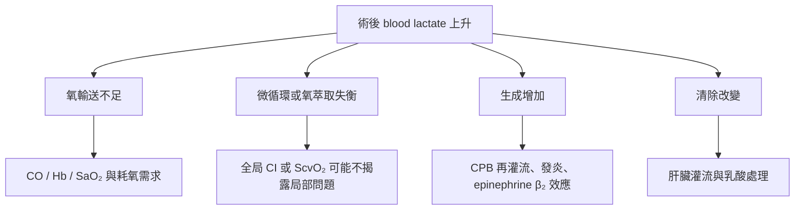

# 乳酸升到 14.8，ScvO₂ 卻是 95%：CABG 術後，究竟該相信哪一個數字？

> Clinical OS｜ABG × Cardiothoracic ICU｜**首次成稿 V1 — frozen baseline**
>
> 2026-10-26。**私人初稿，不得視為已通過醫學 QA 或已正式出版。** 本篇所有個別病人數字均來自 Wardhana & Kurniawaty 2025 原文 Table 1（原始 PDF 第 4 頁；期刊印刷 p278），已目視核對。作者原圖未公開複製；下文表格為選取資料後重新組織、保留原時點與單位的編輯呈現。未經獨立醫師審查與手機實機 QA。

心臟外科病人剛離開手術室，一張術後血氣常常同時給你幾個訊號：pH 是否降低、PaCO₂ 是否能被呼吸器控制、PaO₂ 是否足夠，以及 lactate 是否升高。這些數值有時同方向惡化，有時彼此矛盾。真正困難的不是找出哪一個紅字超標，而是辨認它們分別在回答哪個問題，又有哪一個危險仍然沒有被測到。

2025 年 Wardhana 與 Kurniawaty 報告三名接受 coronary artery bypass grafting（CABG，冠狀動脈繞道手術）的病人。第三名是一位 69 歲男性，術前左心室射出分率（EF）45%，接受心肺繞道（cardiopulmonary bypass，CPB）108 分鐘及主動脈夾閉 91 分鐘。離開 CPB 後，他需要 dobutamine、norepinephrine、epinephrine 及 nitroglycerine；進入 ICU 時血流動力學不穩定，還需要暫時性心臟節律器協助。

術後超音波估計 EF 仍約 45%，cardiac output（CO）5.1 L/min、cardiac index（CI）3.1 L/min/m²。這組數字表面上不符合「心臟完全打不出血」的印象，但它是在強心與升壓支持之下的測量，而且病人當下並不穩定。來 ICU 後四小時，lactate 從 3.6 升到 **14.8 mmol/L**，同一時點記錄的 central venous oxygen saturation（ScvO₂）卻達 **95%**。

現在最容易出現兩種相反、卻同樣過快的結論：有人認為 lactate 14.8 就證明全身缺氧，應該立刻大量補液；另一種說法則認為 ScvO₂ 95%、CI 3.1，氧供既然看起來充分，這一定只是 epinephrine 的代謝效應，不必緊張。

**兩種結論都超出了目前資料能證明的範圍。**

## 01｜第一件事：它們原本就不是在量同一個生理變項

先把四個容易混在一起的量拆開。**Arterial blood gas（ABG，動脈血氣）**是由動脈檢體測得 pH、PaCO₂、PaO₂ 等資料；血氣機依此計算 HCO₃⁻，也可能提供 base excess（BE）與 lactate，視儀器和檢驗項目而定。**ScvO₂** 來自中心靜脈血的氧飽和度，不是同一個動脈數值；心輸出量則必須由另外的血流動力監測或超音波估計。這些資料可以在同一時點綜合判斷，但不能稱為「一張 ABG 已經全部告訴我們」。

Lactate 是血中乳酸根的濃度，受到生成、分布與清除共同影響。它升高時可能伴隨缺氧性代謝，但也可能見於強烈的腎上腺素能刺激、術後代謝壓力或清除受損。**BE** 描述將血液在標準化 CO₂ 條件下校正回參考 pH 所需的酸鹼量，是代謝性酸鹼成分的摘要，而不是 lactate 的另一種單位。ScvO₂ 則反映取樣範圍內的靜脈血仍有多少氧飽和度，取決於供氧、耗氧、氧萃取、混合及採樣條件。

原報告 Table 1 恰好有一個重要限制：它列出 lactate、BE、ScvO₂、venous–arterial CO₂ gap 與 glucose，**沒有提供可完整重建同時點酸鹼障礙的 pH、PaCO₂、PaO₂、HCO₃⁻ 或 Hb 時序**。因此，我們可以說第四小時有顯著 lactate 上升與負 BE，卻不能替這名患者補出「pH 7.XX」或精算 anion gap、Winter 預期代償、P/F ratio。這不是文章資料不漂亮的問題，而是床邊醫師辨認證據邊界的基本工作。

## 02｜回到同一個人：Lactate 不變，為什麼 BE 可以改善？

原文以 T0 表示到 ICU 時、T1 表示 ICU 後 4 小時、T2 表示 8–10 小時、T3 表示 12–14 小時、T4 表示 18–20 小時、T5 表示 24–30 小時。下表只選取第三名病人的三個變項，未測項記作「未提供」，沒有插補。

| 原文時點 | Lactate (mmol/L) | BE (mEq/L) | ScvO₂ (%) |
| --- | ---: | ---: | ---: |
| T0，ICU 到院 | 3.6 | −7.69 | 92.6 |
| T1，4 小時 | **14.8** | **−15.7** | **95.0** |
| T2，8–10 小時 | **14.8** | −7.90 | 92.1 |
| T3，12–14 小時 | 8.0 | −3.8 | 82.0 |
| T4，18–20 小時 | 2.8 | +2.92 | 未提供 |
| T5，24–30 小時 | 1.9 | +2.0 | 未提供 |

*資料身分：Wardhana & Kurniawaty 2025，Table 1；T0–T5 為原文實際時距，不是每四小時等間隔。BE 與 lactate 不同單位，不能在同一縱軸當成可加總的量。*

最值得問的不是 lactate 的高峰，而是 **T1 到 T2 的變化**：lactate 同樣 14.8，BE 卻從 −15.7 改善到 −7.9。若把 lactate 直接當作「血液酸化程度」的唯一尺度，就無法理解這個現象。

原因在於兩者不是同一個量。Lactate 是一種可測的陰離子；BE 總結的是血液整體代謝性酸鹼影響，包括 lactate 以外的 strong ions、albumin 與其他未量測的酸鹼因素。兩者可能在一段時間內不同步。**但這份報告沒有足夠的同時點 chloride、albumin、其他離子及治療輸入時序來辨識究竟哪個因素造成 BE 改善**。我們只能指出「lactate 沒有完整解釋酸鹼演變」，不能藉此替病人診斷高氯性酸中毒或聲稱已知 bicarbonate 的功效。

這就是既有〈pH 正常，為什麼仍可能有兩個酸鹼障礙？〉在心臟外科 ICU 真正派上用場的地方：不是再背一遍公式，而是不要把不同量測層次誤寫成同一條病程。

## 03｜ScvO₂ 95%，為什麼無法替全身灌流蓋章？

氧氣到達組織，至少有兩個不同步驟。第一個是動脈血攜帶多少氧；第二個是心臟每分鐘把多少血送出去。

在簡化而常用的近似中：

**CaO₂（動脈血氧含量，mL O₂/dL）≈ 1.34 × Hb(g/dL) × SaO₂ + 0.003 × PaO₂(mmHg)**

**DO₂（每分鐘系統性氧輸送，mL O₂/min）≈ CO(L/min) × CaO₂(mL/dL) × 10**

所以即使 SpO₂ 或 SaO₂ 很高，只要 Hb 下降，或 CO 在病人的需求下不足，氧輸送仍可能不夠。CPB 的血液稀釋、手術後出血、低心輸出與氧耗增加，都會讓「氧飽和度漂亮」與「組織實際得到足夠氧」分離。

ScvO₂ 的意義又不同。它是上半身回到中心靜脈的血液，經組織耗氧之後剩下多少飽和度。ScvO₂ 低可能提示供需失衡；但 ScvO₂ 很高，只能證明所取樣的靜脈血仍高度氧合，**不能證明所有器官都充分灌流、所有微血管都有效交換、細胞都能正常利用氧**。在心臟術後，局部缺血、微循環失衡、萃取改變、取樣位置，以及持續的藥物或機械支持，都可能使全局指標與器官風險分離。

更要注意第三名病人的時間點：他接受 epinephrine 和其他循環藥物，臨床需要 pacing。量到 CI 3.1 不是沒有支持下的原生心功能，也不是未來每一小時都相同的 CO。把這個快照當作「已排除低心輸出、出血或 tamponade」，是把觀察值誤當成排除性檢驗。

**ScvO₂ 95% 不該讓我們放棄評估缺血；lactate 14.8 也不該讓我們先忘記輸液可能加劇心臟負荷與肺水腫。**

## 04｜那麼 lactate 為什麼會升高？機轉不只一條

過去乳酸經常被直覺理解為「沒有氧，所以開始無氧代謝」。這是一個重要但不完整的模型。細胞進行 glycolysis 後產生 pyruvate；lactate dehydrogenase 讓 pyruvate 與 lactate 相互轉換，並參與 NAD⁺ 的再生。即使有氧，lactate 也不會停止生成，它可以是可供其他組織利用的代謝燃料。

CABG 與 CPB 後，至少要同時考慮四條路徑：

*原創功能分支圖：四條路徑可同時存在，不是互斥診斷。圖中的項目是需要逐項驗證的候選原因，不代表第三名患者均已證實。*

Epinephrine 的 β₂-adrenergic effect 可以增加 glycolytic flux，使乳酸生成增加，不一定等同組織缺氧。這也是為什麼第三名病人在接收 epinephrine 後出現顯著 lactate 高峰時，原作者會提出 type-B mechanism 的假說。

但要特別保留兩個限制。**第一，時間相關不等於已證實藥物單獨造成乳酸上升**。第二，缺氧性與非缺氧性機轉可以共存。心臟手術病人可以在接受 catecholamines 的同時，也發生出血、右心衰竭、low cardiac output syndrome（LCOS）或區域缺血。若把任何一種機轉宣稱為確定答案，就會跳過真正需要診治的危險。

2024 EACTS/EACTAIC/EBCP CPB guideline 將 LCOS 與器官灌流不足連結，提醒不能只看動脈血壓，而應整合 lactate、靜脈血氧飽和度及周邊灌流徵象。它也指出 CPB 相關的酸化可來自氧供問題及電解質／輸液變化；這些不同路徑不應混在「術後酸中毒」四個字之下。

## 05｜同樣是 CABG，三個人的 lactate 曲線能不能互相解釋？

原文另兩名病人提供了重要的反例。

第一名 65 歲男性術後 TTE 測得 CI 3.86 L/min/m²，接受 dobutamine 與 nitroglycerine，T1 lactate 8.3 mmol/L，ScvO₂ 79.7%；其後 lactate 下降。第二名 65 歲男性術後 CI 2.62 L/min/m²，也描述為相對穩定，但 lactate 到 ICU 後 12–14 小時仍達 8.7 mmol/L，18–20 小時仍為 8.6 mmol/L。第三名的乳酸則在四小時迅速升到 14.8，之後明顯下降。

三人共同經歷 CPB 與 CABG，卻沒有一致的高峰時間、血糖反應或循環支持條件。這表示一個「CABG 後標準乳酸曲線」不足以讓我們為每一個病人下診斷。第一名 CI 高、第二名升得較晚、第三名使用 epinephrine，各自提供不同線索；**但任何一個指標都不是已確認的單一因果解釋**。

較早的文獻將心臟術後 late-onset hyperlactatemia 視作可能自限的現象，尤其在心輸出與氧輸送保留、沒有低灌流徵象的特定族群；這是群體經驗，不能當成「只要升得晚就一定安全」的床邊規則。2026 年一項大型觀察性研究也報告，高峰幅度與晚期高峰時間與不良預後風險相關；這同樣是預後關聯，並不直接告訴我們哪個術後病人必須補多少液體。

**因此，lactate 的時間序列有價值，因為它幫助我們發現需要解釋的變化；但它本身還不是病因診斷。**

## 06｜真正回到床邊：哪個決策不能等到查完所有機轉？

遇到 CABG／瓣膜／主動脈術後乳酸突然快速上升，首要工作不是在 Type A 與 Type B 之間先選一個標籤。應同時確認病人是否正因持續出血、阻塞性問題或心功能惡化而失去可逆的生理儲備。尤其術後胸管出血量、心包填塞可能性、血壓與升壓藥需求、心律、皮膚與四肢灌流、尿量、Hb 的趨勢，以及 bedside echo 的心室功能和心包表現，會直接改變處置優先順序。

若有持續出血或急性循環崩潰，就不能等待 lactate 再抽第二次才開始急救與外科團隊評估；若臨床已有容量負荷或右心受損，僅憑 lactate 高便持續輸液，反而可能惡化充血。補液、血液製品、強心／升壓藥或進一步機械循環支持都需要依**具體可逆原因、動態循環狀態與風險**選擇，而不是由單一 lactate threshold 自動觸發。

接著再問可以多取得什麼資訊：同時點完整 ABG（pH、PaCO₂、PaO₂、FiO₂）、電解質／chloride、albumin、lactate、Hb／SaO₂、ScvO₂ 或 SvO₂（明確取樣位置）、echo/CI 與胸管／體液進出量。這些資料不是越多越好，而是各自回答未解的推論：

| 新資料 | 它能幫我們判斷什麼 | 它不能單獨證明什麼 |
| --- | --- | --- |
| pH、PaCO₂、HCO₃⁻、BE 與電解質 | 有何酸鹼過程並存、可能有無氯離子與其他陰離子貢獻 | 低 pH 的唯一原因、特定器官缺血 |
| 同一採樣條件下 lactate 趨勢 | 危險是否持續／數值方向是否改變 | 生成與清除各占多少、是否一定需要補液 |
| Hb、SaO₂、CI/CO | 系統氧輸送是否可能受限制 | 微循環與各器官的氧供均充分 |
| ScvO₂/SvO₂ 與取樣位置 | 特定靜脈回流範圍的氧萃取結果 | 低灌流、局部缺血、氧利用障礙已排除 |
| Echo、胸管出血與床邊灌流 | tamponade、心室功能、出血與支持需求是否成為優先問題 | 所有代謝性乳酸上升的單一原因 |

## 07｜改變一個條件，看看判斷會如何翻轉

**反事實一：** 如果第三名病人的 lactate 一樣 14.8、ScvO₂ 一樣 95%，但胸管出血突然增加，MAP 下降且床邊超音波顯示新發心包壓迫徵象，此時所謂「epinephrine 造成 Type B」還能當作當下主要工作假說嗎？不能。這些新資料把外科急症的時效性推到第一位。這是教學反事實，**不是原病例真的發生 tamponade**。

**反事實二：** 如果另一名病人乳酸在 ICU 第六小時升高，但 Hb、循環支持需求、尿量、echo、周邊灌流與後續 lactate 趨勢都維持穩定，是否意味著已證明沒有局部缺血？仍然不能。只是這些資料提高了非缺氧性機轉的解釋力，降低某些即刻全局灌流危機的可能性，並使無目的補液的理由更弱。

**反事實三：** 如果同時點 lactate 下降、BE 改善，卻出現新發 PaCO₂ 升高與意識惡化，可以把它記錄為「酸鹼代謝改善，病人比較安全」嗎？不能。這個問題轉回呼吸泵、氣道安全與有效肺泡換氣；需要讀既有高碳酸與 NIV 文章，而不是在這篇重複一次 V̇A 的公式。

## 結語

CABG 術後的一張血氣與同時點的靜脈血氧資訊，是不同生理流程在某個時間留下的共同結果。真正的臨床推理不是選擇相信 lactate 還是 ScvO₂，而是知道：**lactate 告訴我們有一段代謝過程需要被解釋；BE 告訴我們代謝性酸鹼效應如何演變；ScvO₂ 描述取樣血液的氧萃取結果；心輸出、血紅素與床邊循環觀察，才讓我們開始檢驗氧輸送與重要器官風險。**

這些訊號可以同時成立，也可能互相掩蓋。術後醫師的工作，就是在不完整的資訊下，先辨識不能等待的危險，再以每一項新證據修正機轉；而不是讓任何單一數字替整個病人下結論。

---

## 來源與查核界線（私人初稿附錄，正式公開版須另建來源頁）

1. Wardhana A, Kurniawaty J. *Hyperlactatemia Post-CABG: Case Studies in Three Patients.* MajAnestCriCare. 2025;43(3). DOI: [10.55497/majanestcricar.v43i3.429](https://doi.org/10.55497/majanestcricar.v43i3.429)。[原始 10 頁 PDF](https://macc.perdatin.org/index.php/my-journal/article/download/429/365/3106)。已目視印刷 p278 Table 1、p279 Figure 1；三病例與各時點逐欄對照。Table 1 未提供完整 pH、PaCO₂、PaO₂、Hb，不能補造。
2. Wahba A et al. [2024 EACTS/EACTAIC/EBCP Guidelines on cardiopulmonary bypass in adult cardiac surgery](https://pmc.ncbi.nlm.nih.gov/articles/PMC11826095/)，online 2025-02-14。對照 LCOS／DO₂／hyperchloraemic acidosis 與 CPB。此文是專業指引，不能把所有圍手術建議都視作所有術後病人的固定處方。
3. Minton J, Sidebotham DA. [Hyperlactatemia and Cardiac Surgery](https://pmc.ncbi.nlm.nih.gov/articles/PMC5347225/). J Extra Corpor Technol. 2017;49:7–15。用於 early/late 與生成/清除機轉，**2017 年對晚發型自限的敘述不可充當現行排除低灌流規則**。
4. *Severity and timing of elevated lactate correlates with mortality after cardiac surgery.* [PubMed PMID 42637069](https://pubmed.ncbi.nlm.nih.gov/42637069/)，2026。檢索摘要支持 peak magnitude/timing 與 outcome 關聯；**本輪尚未完成全文與方法的獨立評估，不引用其閾值作 bedside intervention cutoff**。
5. *Rethinking Lactate in Cardiac Surgery and Intensive Care.* [PMID 41963151](https://pubmed.ncbi.nlm.nih.gov/41963151/), 2026 narrative review。只用作機轉背景，不以評論替代病人時序。

**Figure audit**：第三方 Table 1 / Figure 1 已私人目視，公開頁不得假定有原圖重製權；此私人 V1 的精簡表與 Mermaid 為原創教學重組。**Pocket 9E source audit**：既有 acid-base-sources.md 記錄 p158–162 已核；此 V1 尚未在本輪重新目視 Pocket 原圖。**QA 狀態：HOLD**：尚未獨立醫學審查、真正 375–390px 手機圖像驗收、全站 Figure Gate、學習遷移實測。**首次成稿不允許因後續回饋而原地覆寫**；後續稿件另命名 v2，保留此 commit 的原始品質基線。
